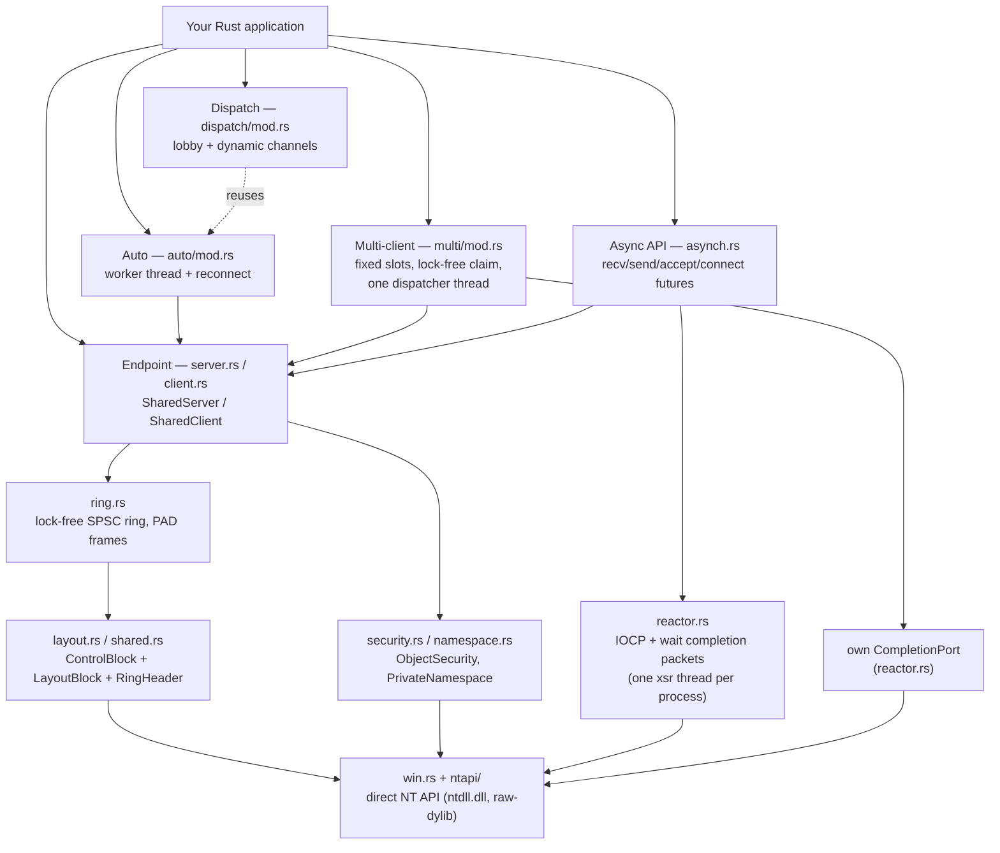
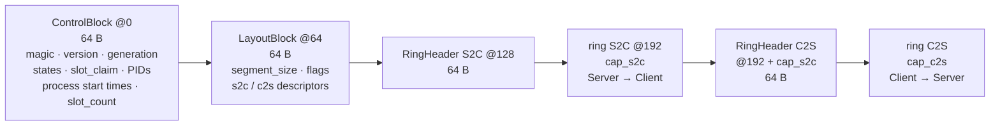
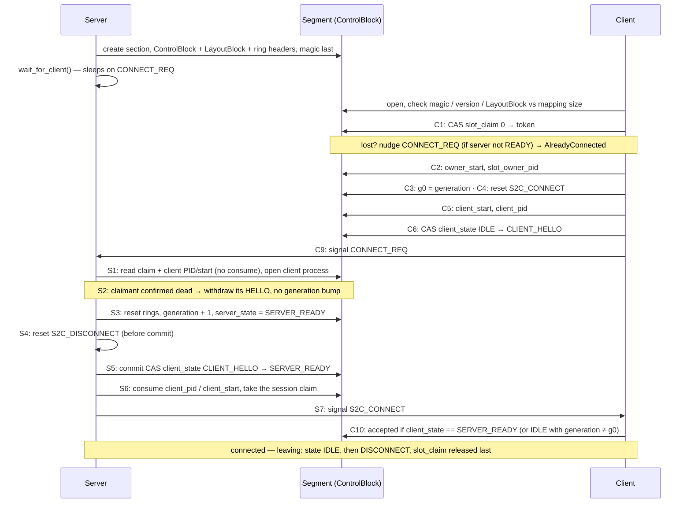
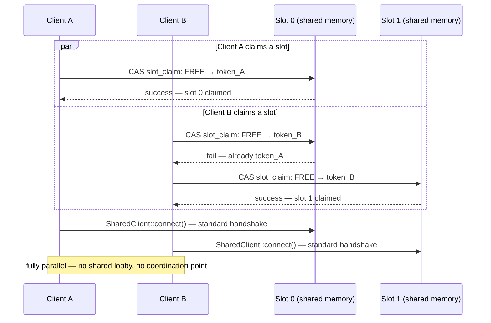

> **C-core migration preview (`feat/c-core`).** The experimental `c-core`
> feature exposes `xshm::c_core` backed by the shared xipc C implementation.
> Single channels, namespace/beacon ownership and caller-driven Multi/Dispatch
> loops, bounded Dispatch/client workers and full-duplex backpressure waits
> are implemented. The prof-shm consumer is being migrated in a separate branch;
> the default API switch is pending.
> This is not the complete replacement release. The default 0.10 API below
> remains a temporary reference.
> API compatibility is secondary to ownership and safety. The final migration
> will remove the independent Rust protocol implementation.
>
> Set `XIPC_SOURCE_DIR` to the canonical `xhook/ipc` source directory, then run
> `cargo test --features c-core --test 'c_core*' -- --test-threads=1`.
> This requires xipc 2.2+, CMake 4 and MSVC. Alternatively set `XIPC_SDK_PREFIX` (not both)
> to an installed hosted Release SDK matching the Rust target and CRT.
> With this repository's static CRT flags, build the SDK using
> `-DXIPC_CRT_FREE=OFF -DCMAKE_MSVC_RUNTIME_LIBRARY=MultiThreaded`.
> C ABI layout, architecture and CRT are checked before linking.
> Multi loops stay on their creating thread; only their wake handle crosses
> threads. Session identities reject stale slots and identities from other servers.
> Both workers inherit the creator thread's startup hook (including profiler
> suppression). Security::Descriptor uses immutable Arc bytes; C validates and
> copies the descriptor before returning, including policy for future channels.
> CommandCompletion confirms the C operation, not peer consumption. wait_timeout
> limits the wait without cancelling a queued command; callbacks cannot wait on
> their own worker. lobby_exists is a discovery hint, not an access check.

<div align="center">

# xShm

**High-performance cross-process shared memory IPC for Windows**

Bidirectional messaging over lock-free SPSC ring buffers, backed by direct NT API calls. A pure Rust crate — no C/C++ FFI.

<p>
  
  
  
  
  
</p>

<p>
  <a href="README.md"></a>
  <a href="README.ru.md"></a>
</p>

</div>

---

## 🆕 What's New in v0.10.0

> **Breaking:** new shared-memory format `0x00020000`. 0.9 peers (and native
> peers written against the 0.9 contract) are rejected by version with
> `ShmError::VersionMismatch` — upgrade both sides. The full list of API changes
> is the *Migration from 0.9* table in [`CHANGELOG.md`](CHANGELOG.md); the
> wire contract for native peers is [`INTEROP.md`](INTEROP.md) (in Russian).

- ✅ **Per-direction channel layout** — `RingConfig { capacity, max_messages,
  max_message_size }` for each direction, combined in `ChannelLayout
  { server_to_client, client_to_server }`. Capacity is a power of two from
  4 KiB to 1 GiB, a message may be up to `capacity / 2 − 8` bytes (far beyond the
  old 64 KiB). The server picks the layout and writes it into the segment
  (`LayoutBlock`); the client reads it from there and checks it against the real
  mapping size. `SharedServer::start_with(name, &ChannelConfig)`, `layout` fields
  in `AutoOptions`/`MultiOptions`, `channel_layout`/`lobby_layout` in
  `DispatchOptions`. The default layout is the 0.9 one (2 × 2 MiB, 500 messages,
  65 535 bytes).
- ✅ **Object security** — named objects are no longer created with a NULL DACL:
  `ObjectSecurity::CurrentUser` (token user + SYSTEM) by default,
  `CurrentUserAllowLowIntegrity`, `Everyone` (the ≤ 0.9 behavior) or your own
  `Descriptor`. A denied open is `ShmError::AccessDenied`. See
  [Object Security](#object-security-010).
- ✅ **Presence beacon** — every named server (single-client, Auto, Dispatch lobby,
  Multi base) raises `<name>_beacon` once it is ready and lowers it first on
  shutdown; `AutoClient`/`MultiClient` without a server sleep on it instead of
  retrying every 250 ms and connect as soon as the server appears;
  `SharedClient::wait_for_server`. See [Server discovery](#server-discovery).
- ✅ **Private namespaces** — `PrivateNamespace` puts channels, lobbies, Multi slots
  and beacons into a boundary-descriptor directory that other users cannot see or
  squat. See [Private Namespace](#private-namespace-010).
- ✅ **Zero-copy** — a frame never wraps around the ring end any more (a PAD frame
  fills the tail), so the payload is always contiguous: `send_with(len, |buf| ..)`
  fills the message in place (safe), `unsafe receive_with(|msg| ..)` reads it in
  place (`ShmError::Overrun` if the writer overwrote it meanwhile); Auto can deliver
  `on_message` straight from the ring via `unsafe AutoOptions::zero_copy_delivery`.
  See [Zero-copy](#zero-copy-010).
- ✅ **Async API** — `accept_async`/`connect_async`/`recv_async`/`send_async` on
  `SharedServer`/`SharedClient`, executor-agnostic (`core::task` only), driven by one
  process-wide IOCP reactor thread instead of a thread per channel. See
  [Async API](#async-api-010).
- ✅ **Adaptive spin** — `SpinPolicy { iterations }` re-checks the ring before going
  to sleep (`poll_*_spin`, `wait_for_space_spin`, `spin` fields in the options).
  Off by default (zero idle wake-ups stay); with `--spin 2000` the 16-byte
  round-trip p50 drops by about an order of magnitude (≈ 6.8 → 0.6 µs on an idle machine). See [Spin](#spin-before-waiting-010).
- ✅ **Multi-client on one thread** — the server serves all slots (up to 256) from a
  single dispatcher thread on its own I/O completion port instead of a worker per
  21 slots. Draining a departed client is bounded, and a panicking callback is isolated
  to its slot (`on_error(Some(slot), WorkerPanicked)`).
- ✅ **Exclusive single-client claim (handshake revision 3)** — a client takes the
  channel by CAS on `slot_claim`; a second client gets `ShmError::AlreadyConnected` at
  once instead of overwriting the first one's request. A crashed holder is released by
  the server (immediately on confirmed death, or `RESERVE_TIMEOUT` after a losing client's
  nudge) — still no idle timers. Proven by an exhaustive model of two clients and a
  server (`handshake_model`, ≈1.9 M states).
- ✅ **Busy channel without polling** — a client that gets `AlreadyConnected` (or a
  `MultiClient` with no free slot) sleeps in the kernel on the server's
  "claim released" event `<name>_free` (`<base>_multi_free` for Multi) and on the holder
  and server processes, and connects as soon as the holder leaves. Every claim release
  bumps a generation counter and signals the event only when someone waits — no system
  call otherwise. `SharedClient::wait_connectable(name, timeout)` waits the same way
  without connecting (INTEROP R20/R21).
- ✅ **Dispatch admission** — `DispatchHandler::admit` → `Admission::{Accept,
  AcceptWithLayout, Reject}` runs before a channel is created; `max_clients` (64);
  the lobby protocol is strict (bad length, trailing bytes, invalid UTF-8 → `Corrupted`).
- 🔒 **Hardening** — PID-reuse-proof peer identity (process creation time stored next to
  each PID), only `SEC_COMMIT` sections are accepted, every value from the peer is
  bounds-checked (fuzzed `attach`, hostile-peer tests), beacons remember their server
  (`<name>_beacon_state`, `clear_if_stale` never lowers a live server's beacon),
  `SharedServer`/`SharedClient` are `!Sync` (concurrent `&self` calls raced on one side
  of an SPSC ring).
- 🐛 **Lost `DATA` signal fixed** — the writer now decides by ring positions with a
  re-check, and the reader confirms "empty" after a full fence; previously a message
  could sit unread until the next one.

**Migrating from 0.9** — typical changes:

```rust
use xshm::{AutoOptions, ChannelLayout, ClientRegistration, ObjectSecurity, RingConfig};

// 0.9: ClientRegistration { pid, revision, name }  (a new field was added)
let registration = ClientRegistration::new(std::process::id(), 1, "my_app");

// 0.9: struct literals of options without `..Default::default()` no longer compile
let options = AutoOptions {
    // service in session 0 <-> user process over Global\: restore the 0.9 NULL DACL
    security: ObjectSecurity::Everyone,
    // optional: large server-to-client snapshots, small commands back
    layout: ChannelLayout {
        server_to_client: RingConfig::new(32 << 20).max_message_size(4 << 20),
        client_to_server: RingConfig::new(64 << 10),
    },
    ..Default::default()
};

// 0.9: xshm::MAX_MESSAGE_SIZE (now a deprecated alias of the default)
// 0.10: the limit of a live channel, e.g. `server.free_space().max_message_size`
```

## Previously in v0.9.0

- ✅ **Fully event-driven Auto/Dispatch workers** (breaking: `poll_timeout` is now
  `Option<Duration>`, default `None`) — every worker, lobby and pending-connect
  thread sleeps in the kernel until something happens: data, space, disconnect,
  peer death, a new command (`send`/`try_send`/`stop` wake the worker through a
  private unnamed event) or shutdown. Zero wake-ups while idle; sends are no
  longer delayed until the next 50 ms poll tick. `Some(t)` keeps an optional
  safety-net timeout.
- ✅ **Event-driven Multi-client** (breaking: `MultiOptions`/`MultiClientOptions::poll_timeout`
  are `Option<Duration>`, default `None`; new `MultiClientOptions::retry_delay`) — no 50 ms
  tick any more. Server workers (one per 21 slots) sleep on `CONNECT_REQ` / `DISCONNECT` /
  `DATA` / the client's process handle / a private `wake` event and time out only at the
  nearest *deadline* (stale slot claim, one-shot abandoned-handshake check). A dead client
  is detected by its process handle (`on_client_disconnect_reason(PeerDied)`), a client that
  finds no free slot nudges the server so a crashed claimer's slot is freed exactly at its
  deadline. New `on_client_disconnect_reason` / `on_disconnect_reason` default methods,
  `MultiServer::is_client_alive`. Tests prove 0 wake-ups per idle second on every side.
- ✅ **`wait_for_space` without slicing** — one kernel wait for the whole timeout on
  `[SPACE, DISCONNECT, peer process]`; a graceful peer disconnect returns
  `Err(NotConnected)` instead of waiting out the timeout.
- ✅ **Dispatch lobby serialized** — clients take the named mutex `<lobby>_lock` for the
  whole lobby handshake (two simultaneous clients could read each other's reply);
  channel names inherit the lobby namespace (`Global\<hex>`), so cross-session Dispatch
  works; `Beacon::open` rejects a squatted auto-reset event of the same name.
- ✅ **`Beacon` — event-driven server discovery** — a named manual-reset
  notification event `<name>_beacon`: the server `raise`s it right after its
  lobby exists and `lower`s it before stopping; clients sleep in `wait()` /
  `wait_any()` and all wake at once — no connect-polling while no server exists.
  `open` creates or opens (any start order), `is_raised()` checks without
  waiting. `Beacon::unnamed()` is a private unnamed event of the same kind
  (e.g. a stop signal next to the beacon in `wait_any`; it cannot be opened or
  squatted by name). `ProcessExit` holds a process handle and fires when the
  process exits; `xshm::wait_any(&[&dyn Waitable], timeout)` waits on beacons
  and process exits together. See [Server discovery](#server-discovery).
- ✅ **Dispatch hardening** — `DispatchServer::start` creates the lobby
  synchronously (a busy name is an error, not silent background retries);
  a client is announced (`on_client_connect`) on its channel worker **before**
  its first `on_message` (early messages used to arrive for an unknown client
  and were lost); messages queued before `disconnect_client`/`stop` are
  flushed into the ring and the peer drains them before its `on_disconnect`
  (a farewell message with a reason now arrives); `stop()` wakes every thread
  by event instead of waiting for poll ticks or `channel_connect_timeout`;
  `DispatchClient::lobby_exists(name)`.
- ✅ **Space events for senders** — `DispatchClientHandler::on_space_available()`
  and `DispatchHandler::on_space_available(client_id)` (default no-op): a
  lossless sender that got `QueueFull` sleeps until the peer frees space
  instead of sleeping in a loop. The worker flushes its queue into the freed
  space before the callback.
- 🐛 **Revision 2 (2026-09-25)** — a client disconnected right after the
  handshake (e.g. refused from `on_client_connect`) now receives the farewell
  and `on_disconnect`: the handshake counts as accepted when `generation`
  changed, even if the server is already `IDLE` (it used to roll back and
  reconnect to the vanished channel forever). The handshake is committed by
  CAS on both sides (no stale `S2C_CONNECT` for the next client); a dedicated
  Dispatch channel never reconnects, even after a failed first connect;
  Multi `disconnect_client` keeps the slot claim until the client wakes (two
  clients could end up on one ring); `stop()`/Drop no longer wait for the
  handshake timeout; `MultiServer::stop()` signals clients at once;
  `DispatchServer::stop()` from a handler callback no longer deadlocks.
  Peer-visible rules R15–R17 — [`INTEROP.md`](INTEROP.md).
- 🐛 Beacon test names were not unique (`Instant::now().elapsed()` ≈ 0).

> **Native (C/C++) peers:** the shared-memory layout and the channel kernel objects are
> unchanged, but 0.9 no longer papers over missed signals with a 50 ms poll. What a
> compatible implementation must signal, the new `<name>_beacon` object and the Dispatch
> ordering guarantees are specified in [INTEROP.md](INTEROP.md) (in Russian).

- ✅ **Worker thread start hook** — `xshm::set_thread_start_hook(Some(f))` on a thread
  makes every worker thread the library spawns from it (Auto/Dispatch/Multi workers,
  the per-client channel of a `DispatchServer`, pending-connect and deferred-drop
  threads) call `f()` first; workers spawned by workers inherit it. Other threads'
  xshm objects are unaffected. Used by `prof-shm` to mark its transport threads as
  profiler-internal for memory accounting. Rust-only: nothing changes on the wire.

## Previously in v0.8.0

- ✅ **Lossless writes** — `try_send_to_client` / `try_send_to_server` / `try_send` / `try_send_to` never overwrite unread data (`Err(QueueFull)` leaves the ring untouched); `free_space()` gives a conservative writer-side estimate; `wait_for_space()` sleeps on the `SPACE` event. Layout-compatible with 0.7.0 (`SHARED_VERSION` unchanged).
- ✅ **Reliable peer-crash detection** — peers exchange PIDs during the handshake and each side holds an open handle to the other's process; a killed/crashed peer is noticed within ~1–5 ms (see [Peer liveness](#peer-liveness)). New `DisconnectReason` (`Graceful` / `PeerDied` / `Local` / `Error`) via the default-method callbacks `on_disconnect_reason` / `on_client_disconnect_reason`, `is_peer_alive()` / `peer_pid()` accessors, `ShmError::PeerDied` from `wait_for_space` / `poll_*`. Wire-compatible with 0.7.0 / early 0.8.0 peers (they simply aren't watched).
- ✅ Ring constants (`RING_CAPACITY`, `MAX_MESSAGES`, `MAX_MESSAGE_SIZE`, …) are exported from the crate root.
- 🐛 Auto: a `send` with an invalid length no longer blocks the queue forever — it is dropped and reported via `on_error`.

## Previously in v0.7.0

- ✅ **Pure Rust crate** (breaking) — the entire C/C++ FFI layer is gone: `ffi.rs`, `multi/ffi.rs`, `dispatch/ffi.rs`, the `cbindgen` build step, the generated `include/*.h` headers and the `staticlib` crate type. `xshm` now builds as an `rlib` only and is consumed from Rust. A separate synchronous C23 project covers native consumers.
- ✅ **Zero build dependencies** — `build.rs` now does nothing but `cargo:rustc-link-lib=ntdll`; `thiserror` remains the only runtime dependency
- ✅ **Edition 2024 / modern Rust** — `unsafe extern` for NT imports, if-let chains, strict provenance (`.addr()` / `without_provenance_mut`) instead of `as` casts between ints and pointers, `MaybeUninit` + `spare_capacity_mut` instead of `set_len`-before-write, lint policy in the manifest with `undocumented_unsafe_blocks = "deny"`, `Debug` and `#[must_use]` across the public API
- ✅ **Full audit pass** — `Global\` naming actually works now (cross-session IPC was broken before), `Mapping::open` rejects undersized sections, `MultiClient::is_connected()`/`DispatchClient::is_connected()` stopped lying after teardown, send-queue overflow is reported through `on_overflow`, all `expect()` panics removed from worker threads

## Previously in v0.6.0

- ✅ **Dispatch mode** — a fifth mode (`DispatchServer`/`DispatchClient`): one lobby + a dynamic per-client channel, no fixed upper bound on client count
- ✅ **Multi-client redesign** — the central lobby segment is gone. Clients now concurrently claim a free slot via lock-free CAS on the slot's own memory — fully parallel connects, no shared contention point
- ✅ **Hardening pass** — torn-read protection under ring overflow, dead/orphaned slot detection (liveness-checks the owning process), synchronous `stop()` (no callback can fire after it returns), bounded send queues everywhere
- ✅ **API cleanup** (breaking, pre-1.0) — dropped dead fields, unified naming across modes (`poll_timeout`, `channel_name`), dropped the auto-generated name prefix — the caller now fully owns the visible NT object name
- ✅ **No admin privileges required** — named objects are session-scoped by default; elevated rights are only needed if you explicitly opt into `Global\`

## Features

- Cross-process channel with two ring buffers (server→client and client→server), sized **per direction** (`ChannelLayout`, 4 KiB – 1 GiB each, 2 MiB by default); the layout is self-described in the segment
- Lock-free SPSC rings: independent read/write, overwrite-oldest or lossless (`try_send*`) writes, torn-read-safe under overflow (seqlock-style copy), frames never wrap — zero-copy `send_with` / `receive_with`
- Event-based synchronization via NT API for data/space/connection notifications — zero wake-ups while idle; optional adaptive spin (`SpinPolicy`)
- Executor-agnostic async API on a process-wide IOCP reactor
- Clean start guarantee: buffers reset on each new connection with generation tracking; exclusive claim of a single-client channel (`AlreadyConnected`)
- Object security by creator policy (`ObjectSecurity`, current user + SYSTEM by default) and private namespaces (`PrivateNamespace`)
- Peer liveness via process handles verified by process creation time (PID reuse cannot fool it)
- Handler traits instead of callback structs: `AutoHandler`, `MultiHandler`, `MultiClientHandler`, `DispatchHandler`, `DispatchClientHandler`
- **Auto-mode**: background message processing with callbacks (`on_message`/`on_overflow`), automatic reconnect
- **Multi-client mode**: single server handles up to `MAX_MULTI_CLIENTS` (256) clients via lock-free concurrent slot claim, all slots on one dispatcher thread
- **Dispatch mode**: single lobby + dynamic per-client channel, admission control (`admit`, `max_clients`)
- **Direct NT API**: `ntdll.dll` imported via `raw-dylib` (no `ntdll.lib`, no `GetProcAddress`), no external dependencies
- **Static CRT**: CRT statically linked, no runtime DLL dependencies

## Architecture



## Memory Layout

Each channel is a single Named (or anonymous) Section, mapped into both processes' address space:



Format `SHARED_VERSION = 0x00020000`. The segment size is
`256 + cap_s2c + cap_c2s` (4 194 560 bytes with the default 2 × 2 MiB,
`ChannelLayout::segment_size()`). Ring offsets are written explicitly in
`LayoutBlock` (each descriptor: `offset`, `capacity`, `max_messages`,
`max_message_size`), and the client only checks bounds, so a server may lay the
rings out differently. `magic` is published last.

A frame is `u32 len` + `u32 flags` + payload, padded to 8 bytes. A frame never
crosses the ring end: when it does not fit, the writer fills the tail with a PAD
frame (`flags = FRAME_PAD`) and puts the frame at offset 0, publishing both with one
`write_pos` store — that is why a message is limited to `capacity / 2 − 8`:

```text
 index 0                                              capacity
 |  frame N+1 (len, 0, payload...)  | ... free ... | frame N | PAD (len = tail − 8) |
                                                             ^ write_pos before PAD
```

## How a Connection Is Established

Handshake revision 3 (normative steps C1–C10 / S1–S7 — `INTEROP.md` §d.2,
rules R15, R16, R18):



A client that times out withdraws its request by `CAS CLIENT_HELLO → IDLE` and
releases the claim; losing that CAS with a changed `generation` means it was
accepted after all (it then drains the ring and leaves).

## Choosing a Mode

| | Single-client | Auto | Multi-client | Dispatch |
|---|:---:|:---:|:---:|:---:|
| Clients per server | 1 | 1 | up to 256 (fixed slots) | unbounded |
| Threading | none — caller-driven (or async futures on the shared reactor) | background worker | one dispatcher thread for all slots (server), worker per client | lobby worker + per-client worker |
| Reconnect | manual | automatic | automatic (re-claim) | automatic |
| Connect cost | 1 handshake | 1 handshake | 1 CAS + 1 handshake | 1 lobby round-trip + 1 handshake |
| Best for | simplest pairwise IPC, driver integration | one peer, needs resilience | known/bounded fleet size | fleet size unknown ahead of time |

## Channel Naming

The name you pass to any constructor becomes the kernel object name as-is; the
namespace is chosen by its prefix:

| You pass | Section object | Namespace |
|----------|----------------|-----------|
| `"Chan"` | `Local\Chan` | session-local |
| `"Local\Chan"` | `Local\Chan` | session-local (prefix is not doubled) |
| `"Global\Chan"` | `Global\Chan` | global — needed for cross-session IPC (service in session 0 ↔ desktop process) |
| `"\BaseNamedObjects\Chan"` | as-is | raw NT path |

Channel events always land in the same namespace as the section.

## Object Security (0.10)

**NULL DACL is no longer the default.** Every named object xshm creates (channel
section and its 7 events, Multi slots, Dispatch lobby, its `<lobby>_lock` mutex
and per-client channels, beacon and `<name>_beacon_state`) gets the security
descriptor chosen by its **creator** (`ObjectSecurity`); openers pass none and are
checked against the creator's DACL. A denied open is `ShmError::AccessDenied`.

| Policy | DACL / SACL | Use for |
|--------|-------------|---------|
| `ObjectSecurity::CurrentUser` (default) | user SID of the process token + SYSTEM (`S-1-5-18`), `GENERIC_ALL` | peers of the same user |
| `ObjectSecurity::CurrentUserAllowLowIntegrity` | same + Low mandatory label `S:(ML;;NW;;;LW)` | sandboxed Low-IL processes of the same user |
| `ObjectSecurity::Everyone` | NULL DACL (behavior ≤ 0.9) | service SYSTEM ↔ user over `Global\` with no shared group |
| `ObjectSecurity::Descriptor(bytes)` | your self-relative descriptor (validated) | anything else (e.g. SYSTEM + `Users`, AppContainer SIDs) |

```rust
use xshm::{ChannelConfig, DispatchOptions, ObjectSecurity, SharedServer};

// Service in session 0 talking to desktop processes of other users:
let config = ChannelConfig::default().security(ObjectSecurity::Everyone);
let server = SharedServer::start_with("Global\\MyService", &config)?;
// Auto / Multi / Dispatch: the `security` field of their options
// (Dispatch channels and the lobby mutex inherit `DispatchOptions::security`);
// beacon: `Beacon::open_with(name, &policy)`.
let options = DispatchOptions { security: ObjectSecurity::Everyone, ..Default::default() };
```

**Migrating from 0.9**: a `Global\` channel between a SYSTEM service and a user
process worked with NULL DACL; with the default policy the user gets
`AccessDenied` when the service creates the objects. Use `ObjectSecurity::Everyone`
(or a `Descriptor`) on the creating side.

## Private Namespace (0.10)

A DACL keeps other users from *opening* your objects, but in the shared
`\BaseNamedObjects` anyone can still *see* the names and pre-create them (squat).
`PrivateNamespace` moves a channel, lobby, Multi slots or beacon into a kernel
object directory that is found by a **boundary descriptor** — boundary name +
the process user's SID (+ the Low label for `CurrentUserAllowLowIntegrity`) —
instead of by name. Only processes of the same user can open or create it; for
everyone else the objects do not exist (`STATUS_OBJECT_NAME_NOT_FOUND`).

```rust
use std::sync::Arc;
use std::time::Duration;
use xshm::{ChannelConfig, ObjectSecurity, PrivateNamespace, SharedClient, SharedServer};

// Both sides call open_or_create with the same boundary and policy.
let ns = PrivateNamespace::open_or_create("MyApp", "myapp", &ObjectSecurity::default())?;
// Names inside are relative: no `Local\` / `Global\` (that is `InvalidConfig`).
let server = SharedServer::start_with("Chan", &ChannelConfig::default().namespace(Arc::clone(&ns)))?;

// Client process:
let ns = PrivateNamespace::open_or_create("MyApp", "myapp", &ObjectSecurity::default())?;
let client = SharedClient::connect_in(&ns, "Chan", Duration::from_secs(2))?;
// Auto / Multi / Dispatch: `namespace: Some(ns)` in their options (Dispatch
// channels live in the lobby's namespace); beacon: `Beacon::open_in(&ns, name, &policy)`.
```

The namespace lives while any process holds a handle to it; xshm never deletes
it (`NtDeletePrivateNamespace`), so a restarted server and a reconnecting client
meet in the same one. `alias` is diagnostic only (like Win32 `lpAliasPrefix`).
Same-user processes still pass the boundary — it is not isolation between
processes of one account. Cross-user setups (SYSTEM service ↔ user) cannot share
a namespace (different SIDs); use `Global\` + `ObjectSecurity` there.

## Requirements

- Windows 10/11
- Rust 1.99+ (stable) — edition 2024 and `rust-version = "1.99"` in the manifest
- MSVC toolchain (MinGW targets were dropped in 0.7.0 together with the C ABI)
- **No administrator privileges required** — named kernel objects are session-scoped (`Local\` prefix → `\Sessions\<SessionId>\BaseNamedObjects\`). Elevated rights are only needed if you explicitly use the `Global\` prefix

## Dependencies

**Minimal dependencies** — only `thiserror` for error handling:

```toml
[dependencies]
thiserror = "2"
```

NT API calls are imported directly from `ntdll.dll` with
`#[link(name = "ntdll", kind = "raw-dylib")]`:
- No `ntdll.lib` from the Windows SDK needed
- No SSN dependency
- No GetProcAddress at runtime

## Build

Add it as a path or git dependency:

```toml
[dependencies]
xshm = { path = "../xshm" }
```

```bash
cargo build --release                                   # x64 MSVC (default)
cargo build --release --target i686-pc-windows-msvc     # x86 MSVC

# Run tests
cargo test -- --test-threads=1   # sequential: tests share named-object namespaces
```

The crate builds as an `rlib` only. `build.rs` only emits `rerun-if-changed`; the
`ntdll` imports are `raw-dylib`, so no import library is needed in the consuming
binary's build either.

```bash
cargo run --release --example bench -- throughput 4096 5          # SharedServer -> SharedClient
cargo run --release --example bench -- latency 16 5 --spin 2000    # ping-pong RTT with spin
cargo run --release --example bench -- throughput 1048576 5 --zero-copy
```

## Rust Usage

```rust
use std::thread;
use std::time::Duration;
use xshm::{SharedClient, SharedServer};

fn main() -> xshm::Result<()> {
    let name = "ExampleChannel";

    let server_thread = thread::spawn({
        let name = name.to_owned();
        move || -> xshm::Result<()> {
            let mut server = SharedServer::start(&name)?;
            server.wait_for_client(Some(Duration::from_secs(5)))?;
            server.send_to_client(b"ping")?;
            let mut buffer = Vec::new();
            let len = server.receive_from_client(&mut buffer)?;
            println!("client -> server: {:?}", &buffer[..len]);
            Ok(())
        }
    });

    thread::sleep(Duration::from_millis(50));

    let client = SharedClient::connect(name, Duration::from_secs(5))?;
    let mut buffer = Vec::new();
    let len = client.receive_from_server(&mut buffer)?;
    println!("server -> client: {:?}", &buffer[..len]);
    client.send_to_server(b"pong")?;

    server_thread.join().unwrap()?;
    Ok(())
}
```

### Auto-mode

```rust
use std::sync::Arc;
use xshm::{AutoClient, AutoHandler, AutoOptions, AutoServer, ChannelKind, Result};

struct Logger;

impl AutoHandler for Logger {
    fn on_message(&self, dir: ChannelKind, payload: &[u8]) {
        println!("[{:?}] {}", dir, String::from_utf8_lossy(payload));
    }
}

fn main() -> Result<()> {
    let handler = Arc::new(Logger);
    let server = AutoServer::start("AutoChannel", handler.clone(), AutoOptions::default())?;
    let client = AutoClient::connect("AutoChannel", handler, AutoOptions::default())?;

    client.send(b"hello")?;
    server.send(b"world")?;

    std::thread::sleep(std::time::Duration::from_millis(100));
    Ok(())
}
```

### Multi-client mode

Fixed pool of slots (default 20, hard cap 256; 256 slots × the default
2 × 2 MiB layout ≈ 1 GiB of committed sections — set a small
`MultiOptions::layout` for large `max_clients`). Clients concurrently claim a
free slot via lock-free CAS — no central lobby, no negotiation round-trip:



```rust
use std::sync::Arc;
use xshm::multi::{MultiServer, MultiClient, MultiHandler, MultiClientHandler, MultiOptions, MultiClientOptions};
use xshm::Result;

struct ServerHandler;

impl MultiHandler for ServerHandler {
    fn on_client_connect(&self, client_id: u32) {
        println!("Client {} connected", client_id);
    }
    fn on_client_disconnect(&self, client_id: u32) {
        println!("Client {} disconnected", client_id);
    }
    fn on_message(&self, client_id: u32, data: &[u8]) {
        println!("Message from client {}: {:?}", client_id, data);
    }
}

struct ClientHandler;

impl MultiClientHandler for ClientHandler {
    fn on_connect(&self, slot_id: u32) {
        println!("Claimed slot {}", slot_id);
    }
    fn on_disconnect(&self) {
        println!("Disconnected");
    }
    fn on_message(&self, data: &[u8]) {
        println!("Received: {:?}", data);
    }
}

fn main() -> Result<()> {
    // Start multi-client server (default 20 slots)
    let server = MultiServer::start("MyService", Arc::new(ServerHandler), MultiOptions::default())?;

    // Each client claims a free slot on its own (base name is the same for all)
    let client1 = MultiClient::connect("MyService", Arc::new(ClientHandler), MultiClientOptions::default())?;
    let client2 = MultiClient::connect("MyService", Arc::new(ClientHandler), MultiClientOptions::default())?;
    let client3 = MultiClient::connect("MyService", Arc::new(ClientHandler), MultiClientOptions::default())?;

    println!("Client 1 slot: {}", client1.slot_id());
    println!("Client 2 slot: {}", client2.slot_id());
    println!("Client 3 slot: {}", client3.slot_id());

    // Send to specific client by slot_id
    server.send_to(0, b"Hello client 0")?;

    // Broadcast to all connected clients
    server.broadcast(b"Hello everyone")?;

    // Client sends to server
    client1.send(b"Hello server")?;

    std::thread::sleep(std::time::Duration::from_millis(100));
    Ok(())
}
```

### Dispatch mode

One lobby + a dynamic `AutoServer`-backed channel per client. Unlike
Multi-client there is no fixed slot count — pick this mode when the number
of simultaneous clients isn't known ahead of time.

```rust
use std::sync::Arc;
use xshm::{
    ClientRegistration, DispatchClient, DispatchClientHandler, DispatchClientOptions,
    DispatchHandler, DispatchOptions, DispatchServer, Result,
};

struct ServerHandler;

impl DispatchHandler for ServerHandler {
    fn on_client_connect(&self, client_id: u32, info: &ClientRegistration) {
        println!("Client {} connected (pid {}, {})", client_id, info.pid, info.name);
    }
    fn on_client_disconnect(&self, client_id: u32) {
        println!("Client {} disconnected", client_id);
    }
    fn on_message(&self, client_id: u32, data: &[u8]) {
        println!("From {}: {:?}", client_id, data);
    }
}

struct ClientHandler;

impl DispatchClientHandler for ClientHandler {
    fn on_connect(&self, client_id: u32, channel_name: &str) {
        println!("Registered as client {} on channel {}", client_id, channel_name);
    }
    fn on_disconnect(&self) {
        println!("Disconnected");
    }
    fn on_message(&self, data: &[u8]) {
        println!("Received: {:?}", data);
    }
}

fn main() -> Result<()> {
    let server = DispatchServer::start("MyService", Arc::new(ServerHandler), DispatchOptions::default())?;

    let registration = ClientRegistration::new(std::process::id(), 1, "my_app");
    let client = DispatchClient::connect(
        "MyService",
        registration,
        Arc::new(ClientHandler),
        DispatchClientOptions::default(),
    )?;

    client.send(b"hello")?;
    server.broadcast(b"hello everyone")?;

    std::thread::sleep(std::time::Duration::from_millis(100));
    Ok(())
}
```

### Lossless writes (backpressure)

By default every send path overwrites the oldest unread messages when the
ring is full. When the consumer must see *every* message (e.g. a profiler
stream), use the non-overwriting variants instead:

| Mode | Send without overwrite | Free space |
|------|------------------------|------------|
| Single-client | `SharedServer::try_send_to_client`, `SharedClient::try_send_to_server` | `free_space()`, `wait_for_space(len, timeout)` |
| Auto | `AutoServer::try_send`, `AutoClient::try_send` | `free_space()` |
| Dispatch | `DispatchClient::try_send`, `DispatchServer::try_send_to` | `DispatchClient::free_space()`, `DispatchServer::free_space(id)` |
| Multi-client | `MultiServer::try_send_to` | `MultiServer::free_space(id)` |

Semantics:

- A message is either written **whole** into free space or rejected with
  `ShmError::QueueFull`; unread data is never touched (`overwritten` is always 0).
  Atomicity is the same as for regular sends — the reader sees the whole message or nothing.
- `FreeSpace` (`bytes`, `max_frame`, `messages`, `max_message_size`; `fits(len)`,
  `max_payload()`) is a **lower bound** when taken on the writer side: if `fits(n)`, the
  next `try_send*` of `n` bytes succeeds. Every message costs `frame_size(len)` = 8-byte
  header + payload rounded up to 8, plus a PAD frame when it does not fit before the ring
  end — `fits` decides by `max_frame` (the largest frame that fits contiguously now), not by
  `bytes`. Limits are per direction (`RingConfig`, default 500 messages / 2 MiB); a message of
  `max_message_size` (≤ `capacity / 2 − 8`) always fits an empty ring.
- `wait_for_space` sleeps on the channel's `SPACE` event: the reader wakes the writer only
  once enough space is freed. Since 0.9 it is a single kernel wait on `[SPACE, DISCONNECT,
  peer process]` (no 50 ms slices): a dead reader → `Err(PeerDied)`, a graceful disconnect →
  `Err(NotConnected)`. A 0.7 reader wakes it only when it empties the ring; a crashed reader
  without PID exchange never wakes it — pass a timeout. Anonymous servers wait the same way
  (on their unnamed events) — nothing polls.
- Auto/Dispatch report freed space as an event: `AutoHandler::on_space_available`,
  `DispatchClientHandler::on_space_available()`, `DispatchHandler::on_space_available(id)` —
  a sender that got `QueueFull` waits for it instead of sleeping in a loop.
- Auto/Dispatch are asynchronous: `try_send` returns `QueueFull` once `max_send_queue`
  accepted messages are still waiting for the ring; accepted lossless messages are never evicted
  and are written with the non-overwriting path. The guarantee holds within one connection
  (a reconnect resets the rings). Don't mix `send` and `try_send` on a channel that must be
  lossless — an overwriting `send` may evict earlier messages from the ring.
- One writer per direction, as before (SPSC).

```rust
use std::time::Duration;
use xshm::{SharedServer, ShmError};

fn stream(server: &SharedServer, blocks: &[Vec<u8>]) -> xshm::Result<()> {
    for block in blocks {
        loop {
            match server.try_send_to_client(block) {
                Ok(_) => break,
                Err(ShmError::QueueFull) => {
                    if !server.wait_for_space(block.len(), Some(Duration::from_secs(3)))? {
                        return Err(ShmError::Timeout); // consumer is stuck or gone
                    }
                }
                Err(err) => return Err(err),
            }
        }
    }
    Ok(())
}
```

The wake-up request lives in `RingHeader::space_waiter`: the number of free bytes
the waiting writer needs (frame plus a possible PAD), cleared by the reader that
frees enough space before it signals `SPACE`.

### Async API (0.10)

`SharedServer` and `SharedClient` have executor-agnostic async methods built
only on `core::task` — xshm does not depend on tokio or any other runtime.
Waiting on kernel objects is done by one process-wide IOCP reactor thread,
not a thread per channel, and an idle future is never polled again until a
signal arrives.

| Server | Client | Waits for |
|--------|--------|-----------|
| `accept_async()` | `SharedClient::connect_async(name)` / `connect_async_in(Arc<PrivateNamespace>, name)` | handshake (same protocol as `wait_for_client`/`connect`/`connect_in`) |
| `recv_async(&mut buf)` | `recv_async(&mut buf)` | a message (`Ok(len)`) |
| `send_async(data)` | `send_async(data)` | free space, then writes **without overwrite** |

- Peer disconnected → `Err(NotConnected)`, peer process died →
  `Err(PeerDied)`; `recv_async` reports them only after the ring is drained,
  then marks the endpoint disconnected (the server can `accept_async` again).
- No built-in timeouts: drop the future (e.g. `tokio::time::timeout`).
  Dropping is safe at any point — registrations are cancelled, a consumed
  signal is given back, and a dropped `connect_async` withdraws its
  `CLIENT_HELLO` (or leaves gracefully if the server has already accepted it).
- Methods take `&mut self`, so the futures are `Send` (`tokio::spawn` works).
  Receiving and sending on one endpoint *concurrently* needs a split: wrap it
  in a `Mutex`, or let one task own it and feed it through a channel.
- Anonymous servers work the same way: their events are unnamed, the driver
  signals them (INTEROP §b.5).

```rust,ignore
// Example with tokio (not a dependency of xshm).
use std::time::Duration;
use xshm::{SharedClient, SharedServer};

#[tokio::main]
async fn main() -> xshm::Result<()> {
    let mut server = SharedServer::start("MyAsyncChannel")?;
    let client_task = tokio::spawn(async {
        let mut client = SharedClient::connect_async("MyAsyncChannel").await?;
        client.send_async(b"ping").await?;
        let mut buf = Vec::new();
        let len = client.recv_async(&mut buf).await?;
        assert_eq!(&buf[..len], b"pong");
        xshm::Result::Ok(())
    });

    tokio::time::timeout(Duration::from_secs(5), server.accept_async())
        .await
        .map_err(|_| xshm::ShmError::Timeout)??;
    let mut buf = Vec::new();
    let len = server.recv_async(&mut buf).await?;
    assert_eq!(&buf[..len], b"ping");
    server.send_async(b"pong").await?;

    client_task.await.expect("client task")?;
    Ok(())
}
```

### Zero-copy (0.10)

Frames never wrap around the ring end (PAD frames, see
[Memory Layout](#memory-layout)), so a payload is one contiguous slice in the
shared memory:

```rust
use xshm::{SharedClient, SharedServer};

fn send_in_place(server: &mut SharedServer, frame: &[u8]) -> xshm::Result<()> {
    // Lossless write (like try_send_to_client): fill the slice right in the ring.
    server.send_with(frame.len(), |buf| buf.copy_from_slice(frame))?;
    Ok(())
}

fn checksum_in_place(client: &mut SharedClient) -> xshm::Result<u32> {
    // SAFETY (caller's contract): the server is trusted and writes this
    // direction without overwrite (try_send*/send_with/wait_for_space),
    // so nobody modifies the slice while the closure runs.
    unsafe { client.receive_with(|msg| msg.iter().map(|&b| u32::from(b)).sum()) }
}
```

- `send_with` is safe: the slice is the not-yet-published part of the ring.
- `receive_with` is `unsafe`: the slice points into memory another process can
  write. If an overwrite is detected after the closure returns, the result is
  dropped and `ShmError::Overrun` is returned (defence in depth, not a guarantee).
  For untrusted peers keep the copying `receive_from_*`.
- Both take `&mut self`: a nested or concurrent second read/write of the same
  direction does not compile.
- Auto copies by default; `unsafe { AutoOptions::default().zero_copy_delivery() }`
  hands `on_message` the slice straight from the ring under the same contract.
- Max message: `capacity / 2 − 8` (`max_payload_for(capacity)`).

### Spin before waiting (0.10)

`SpinPolicy { iterations }` re-checks the ring by positions up to `iterations`
times (`std::hint::spin_loop` in between) before sleeping in the kernel. One
budget per sleep: an idle thread spins once, then sleeps without a timeout — zero
idle wake-ups are kept. A successful spin is always followed by a zero-timeout
check of the events, so `DISCONNECT`, `SPACE` and peer death are still noticed.

```rust
use std::time::Duration;
use xshm::{AutoOptions, SharedClient, SpinPolicy};

fn poll_fast(client: &mut SharedClient) -> xshm::Result<bool> {
    client.poll_server_spin(Some(Duration::from_millis(10)), SpinPolicy::new(2000))
}

let options = AutoOptions { spin: SpinPolicy::new(2000), ..Default::default() };
```

Also `poll_client_spin`, `wait_for_space_spin` and the `spin` fields of
`MultiOptions`, `MultiClientOptions`, `DispatchOptions`, `DispatchClientOptions`
(client channels only, the lobby never spins). `SpinPolicy::NONE` (default) is the
0.9 behavior. The price is a busy CPU core while spinning. Measure it on your
machine: `cargo run --release --example bench -- latency 16 5 --spin 2000`.

### Peer liveness

Graceful disconnects are signalled by the `DISCONNECT` event, but a crashed or
killed process signals nothing. Since 0.8 both sides learn the peer's PID during
the handshake and **hold an open process handle** (`SYNCHRONIZE`) for the whole
connection. The process object stays alive while the handle is open and becomes
signalled when the process exits, so death is detected reliably and PID reuse
cannot fool it (re-opening by PID cannot tell "gone" from "access denied").

| Mode | How death is surfaced |
|------|-----------------------|
| Single-client | `poll_client` / `poll_server` / `wait_for_space` return `Err(ShmError::PeerDied)` right away; a graceful leave (`DISCONNECT`) is `Err(ShmError::NotConnected)` once the ring is drained (0.10: `poll_*` take `&mut self` and mark the side disconnected); `is_peer_alive() -> Option<bool>`, `peer_pid()` |
| Auto | the peer's process handle is in the worker's wait set → `AutoHandler::on_disconnect_reason(DisconnectReason::PeerDied)`; `is_peer_alive()`, `peer_pid()` |
| Dispatch | `DispatchHandler::on_client_disconnect_reason(id, PeerDied)`, `DispatchClientHandler::on_disconnect_reason(PeerDied)`; `DispatchServer::is_client_alive(id)`, `DispatchClient::{is_peer_alive, server_pid, disconnect_reason}` |
| Multi-client | the client's process handle is bound to the server dispatcher's completion port → `MultiHandler::on_client_disconnect_reason(id, PeerDied)`, slot freed; `MultiServer::is_client_alive(id)`; the client sees server death → `MultiClientHandler::on_disconnect_reason(PeerDied)` |

- The new callbacks are **default methods** that forward to `on_disconnect` /
  `on_client_disconnect`, so existing handlers keep working. The library calls only
  the `*_reason` variant.
- Everything the peer wrote into the ring before it died is delivered **before**
  `PeerDied` is reported.
- `is_peer_alive()` returns `None` ("unknown") when the peer is an older version
  (no PID in the handshake) or its process could not be opened (e.g. a service in
  another session without rights). Those connections behave exactly like 0.7.
- Measured on Windows 11 (`tests/peer_death.rs`, `TerminateProcess` of the peer):
  1–5 ms from kill to callback / error in all modes.

Protocol: the server writes its PID to `ControlBlock::server_pid` (and its process
creation time to `server_start_lo/hi`) at creation; the client writes its creation
time and PID to `client_start_lo/hi` and `client_pid` before `CLIENT_HELLO`, and the
server consumes them after committing the handshake (revision 3, step S6). The
observer opens the process by PID and compares its creation time: a different time
means the PID was reused — not the peer. A PID whose process is already dead at
handshake time is ignored.

### Server discovery

**Presence beacon (0.10).** Every named server keeps a presence beacon for its
name: `SharedServer::start*`, `AutoServer` and the Dispatch lobby hold
`<name>_beacon`, a `MultiServer` holds one `<base>_multi_beacon` (not one per
slot, and never shared with a channel named `<base>`; a channel literally
named `<base>_multi` would share it, so do not name channels that way);
Dispatch's per-client channels have none. The beacon lives in the channel's
namespace (including a `PrivateNamespace`) with the channel's security policy.
It is raised only after the section and all 7 events are published (Multi:
after all slots) and lowered as the very first step of `Drop`/`stop`, so
"beacon raised, no channel" only ever means "the server crashed".

The beacon is **best effort**: if it cannot be created or raised (the name is
squatted by another object type, a client of another user created it first
with a DACL that excludes the server, missing privilege), the server still
starts and works without it. `presence()` on `SharedServer`, `AutoServer`,
`MultiServer` and `DispatchServer` returns `PresenceStatus::{Active, Disabled,
Unavailable(err)}`.

Clients use it on their own — nothing to write:

- `AutoClient` / `MultiClient` that find **no server** sleep in the kernel on
  `[wake, beacon]` and connect right after the server raises it (no
  `reconnect_delay`/`retry_delay` polling, zero wake-ups while the server is
  absent). A beacon left raised by a crashed server is cleared with
  `clear_if_stale` and the client keeps sleeping. A server that **refuses** the
  client (other memory format, corruption, access denied) is waited out:
  the client sleeps until that server process exits.
- Every discovery wait is bounded by `discovery_fallback` (`AutoOptions`,
  `MultiClientOptions`, `DiscoveryOptions`; default 10 s, `None` = events
  only): a beacon that is squatted and never raised, a server without a
  beacon (native peer without R19, best-effort failure above) or a spoofed
  server identity costs at most one wake-up per interval while no server is
  found — a connected client never wakes for it. An interval below 1 ms (including `Duration::ZERO`) is
  rejected with `ShmError::InvalidConfig`. Server identities in the
  segment and in the beacon state are untrusted: identities without a
  creation time or naming the client itself are ignored, and the segment's
  identity must match the beacon's.
- A **busy** channel (`AlreadyConnected`; Multi `NoFreeSlot`) is not polled
  either (0.10, R20/R21): the client sleeps on the "claim released" event
  `<name>_free` next to the beacon (`<base>_multi_free` for Multi) and on the
  holder and server processes; the holder's leave, a crashed holder or a
  stale claim reclaimed by the server wakes it at once. A claim taken without
  a session is nudged once, plus one re-nudge after `RESERVE_TIMEOUT + 1 s`.
  As a safety net against peers that release a claim without notifying,
  each such wait is also bounded by `discovery_fallback` (10 s by default,
  `None` = events only); a connected client never wakes for it.
- `on_error` reports the same error once while it repeats; a different error
  in between makes the next repeat reported again (`AlreadyConnected` /
  `NoFreeSlot` once per busy episode).
- The old pause remains after a `Timeout`, once after a session ends (not
  after `PeerDied`) and as a fallback when the beacon or `<name>_free` is
  unusable (no access, no `SeCreateGlobalPrivilege` for `Global\`, a server
  without R20 — then a busy channel backs off up to 2 s as before).
- A client that starts first creates the beacon with its own policy
  (`AutoOptions::security`, `MultiClientOptions::security`): the first creator
  sets the DACL, so a `Global\` service with `ObjectSecurity::Everyone` needs
  the same policy on its clients (or must start first). Use the same
  `ObjectSecurity` on both sides; otherwise the server runs without a beacon
  and is found by the fallback.

Synchronous code can wait the same way:

```rust
use std::time::Duration;
use xshm::SharedClient;

if SharedClient::wait_for_server("MyChannel", Some(Duration::from_secs(30)))? {
    let client = SharedClient::connect("MyChannel", Duration::from_secs(2))?;
    // ...
}
```

(`wait_for_server_in(&ns, name, timeout)` for a private namespace;
`wait_for_server_with(name, timeout, &DiscoveryOptions::default().security(..)
.fallback(..))` to choose the beacon policy and the fallback.)

A busy channel can be awaited without polling, too:
`SharedClient::wait_connectable(name, timeout)` returns `Ok(true)` once the
channel's claim was free (it does not take it — a `connect` that loses the
race gets `AlreadyConnected` and simply waits again).

Native peers acting as a server must follow the same rule (INTEROP R19);
otherwise a Rust client that started first finds them only through
`discovery_fallback` (up to 10 s by default).

**Your own discovery loop.** A client that waits for a server (e.g. a profiler
waiting for its viewer) should not poll for it. `Beacon` is a named
manual-reset event — the Dispatch lobby raises it automatically since 0.10;
a manual `raise` is harmless:

```rust
use xshm::{Beacon, DispatchClient};

// Client: sleep until a server appears or we are asked to stop.
let lobby = Beacon::open("MyService")?;
let stop = Beacon::unnamed()?; // raised by our own shutdown path
let mut retry_now = false;
loop {
    if !retry_now && Beacon::wait_any(&[&stop, &lobby], None)? != Some(1) {
        break; // stop
    }
    retry_now = false;
    match DispatchClient::connect("MyService", registration(), handler(), Default::default()) {
        Ok(client) => { /* work until the channel drops */ }
        Err(_) if !DispatchClient::lobby_exists("MyService") => {
            // Beacon raised, no lobby: the server may have crashed. Never
            // `lower()` from a client — `clear_if_stale` resets the beacon only
            // if the raising server's process is gone, and puts it back if a
            // new server raised it meanwhile (beacon generation, 0.10).
            if lobby.clear_if_stale()? {
                retry_now = DispatchClient::lobby_exists("MyService");
            } else {
                /* server process alive: back off (interruptible by `stop`) */
            }
        }
        Err(_) => { /* transient error: back off (interruptible by `stop`) */ }
    }
}
```

Server order: create the lobby first (`DispatchServer::start` is synchronous
and, since 0.10, raises the beacon itself), then `raise()` if you still do it;
on shutdown `lower()` first, then stop. Clients never call
`raise`/`lower` on the named beacon: `raise` publishes the caller as the
server in `<name>_beacon_state`. `ProcessExit::open(pid)`
plus `xshm::wait_any` lets a client that was refused by a server sleep until
that server process exits — still without polling.

## Constants

Re-exported from the crate root. Ring sizes are per channel and per direction
(`RingConfig`); the `DEFAULT_*` values are what `RingConfig::DEFAULT` /
`ChannelLayout::DEFAULT` use. `RING_CAPACITY`, `MAX_MESSAGES` and
`MAX_MESSAGE_SIZE` remain as `#[deprecated]` aliases of the defaults;
`MESSAGE_HEADER_SIZE` is gone (use `frame_size(len)`).

| Constant | Value | Description |
|----------|-------|-------------|
| `SHARED_VERSION` | `0x00020000` | Shared-memory format (`VersionMismatch` otherwise) |
| `DEFAULT_RING_CAPACITY` | 2 MiB | Default ring size per direction |
| `MIN_RING_CAPACITY` / `MAX_RING_CAPACITY` | 4 KiB / 1 GiB | Ring capacity range (power of two) |
| `DEFAULT_MAX_MESSAGES` | 500 | Default limit of unread messages per ring |
| `DEFAULT_MAX_MESSAGE_SIZE` | 65 535 | Default max payload; the hard limit is `max_payload_for(capacity)` = `capacity / 2 − 8` |
| `MIN_MESSAGE_SIZE` | 1 | Min payload (bytes) |
| `FRAME_HEADER_SIZE` / `FRAME_ALIGN` | 8 / 8 | Frame header (`u32 len` + `u32 flags`) and frame alignment |
| `FRAME_PAD` | 1 | `flags` bit of a PAD frame |
| `RECOUNT_MAX` | 64 | Up to this `max_messages` the writer recounts frames for an exact limit; above it the ring may briefly hold `max_messages + 1` |
| `DEFAULT_LOBBY_LAYOUT` | 2 × 16 KiB, 16 msgs, 1 KiB | Default Dispatch lobby layout |
| `multi::DEFAULT_MAX_CLIENTS` | 20 | Default slot count for `MultiServer` |
| `multi::MAX_MULTI_CLIENTS` | 256 | Hard cap for `MultiServer`, set by the slot-scan cost (clients scan slots `0..256` until the first missing one; the server also writes `slot_count` into every slot as a hint, clients never bound the scan by it); all slots are served by one dispatcher thread |

## Event Handles for Kernel Drivers

Every server — named or anonymous — hands out the raw NT handles of its
section and of all 7 channel events, so a kernel driver can act as the
client of the channel and sleep on the same events (event-driven, no
polling). An anonymous server (`SharedServer::start_anonymous()`) has no
names at all: the section and the 7 events are reachable only through
these handles.

```rust,no_run
use xshm::SharedServer;

let mut server = SharedServer::start_anonymous()?;
let section = server.section_handle();
let events = server.get_event_handles();
// events.connect_req, events.connect_ack, events.c2s_data, events.s2c_data,
// events.c2s_space, events.s2c_space, events.disconnect -- pass them and
// `section` to the driver via IOCTL, then wait for it like for any client:
server.wait_for_client(None)?;
# Ok::<(), xshm::ShmError>(())
```

The handles live in the server process and belong to the server: do not
close them; they stay valid while the server lives. The driver references
the objects (`ObReferenceObjectByHandle(.., UserMode, ..)` in the context
of the server process) and owns those references. All events are
auto-reset (`SynchronizationEvent`): the driver signals with `KeSetEvent`
only, never `KePulseEvent`/`KeResetEvent`, and MUST follow the signalling
rules — `CONNECT_REQ` after `CLIENT_HELLO`, `DATA`/`SPACE` by ring
positions, and on unload a graceful leave (still in its session: CAS
`client_state` `SERVER_READY -> IDLE`, then `DISCONNECT` only if that CAS
succeeded): the driver has no process, so the server cannot notice it
vanishing. `DISCONNECT` is one auto-reset event for both sides: before
signalling its leave the driver must stop its own `DISCONNECT` waiters, and
a driver waiter woken after its own side left must re-signal it and exit —
otherwise the driver swallows its own leave and the server never sees it.
The driver determines its own departure from its own leaving flag, set
before the leave CAS; `client_state` alone does not identify who left.
The full driver contract is [`INTEROP.md`](INTEROP.md) §b.5.

## Limitations

- **SPSC**: Strictly one producer and one consumer per channel
- **Overwrite on overflow** (default): New messages evict oldest when queue is full — use `try_send*` for lossless backpressure
- **Windows only**: Uses direct NT API calls, relies on x86/x86_64 TSO memory ordering (not portable to ARM/RISC-V without rework)
- **Message size**: 1 to `max_message_size` of the ring, at most `capacity / 2 − 8` bytes (65 535 by default); larger messages need a larger ring (no fragmentation)
- **Anonymous servers**: the peer (driver) has no process, so the server only learns that it left from its `DISCONNECT` (INTEROP §b.5); no presence beacon
- **Multi-client slot count**: hard cap of 256 concurrent clients (bounds the client slot scan) — use Dispatch mode if you need more. All slots share one dispatcher thread: a slow `on_message` of one client delays the others
- **Native peers**: must implement the 0.10 contract — format `0x00020000`, PAD frames and handshake revision 3 ([`INTEROP.md`](INTEROP.md))
- **Reconnect timers**: an `AutoClient` / `MultiClient` that is *not connected* sleeps on the presence beacon (no server) or on the "claim released" event (busy channel, no free slot); `reconnect_delay` / `retry_delay` remain as a one-off pause after a session and as a fallback against peers without the beacon/`_free` objects (R19/R20). A peer that releases a claim without notifying (no R20) keeps Rust waiters asleep until the holder or server process exits
- **Access control, not authentication**: by default named objects are open only to the creating user and SYSTEM (`ObjectSecurity::CurrentUser`); any process of that same user can still open them, and `ObjectSecurity::Everyone` restores the ≤ 0.9 NULL DACL — do not send secrets

## Project Structure

```
xshm/
├── src/
│   ├── lib.rs             # Main module, public exports
│   ├── ntapi/             # Direct NT API layer (no external deps)
│   │   ├── mod.rs         # Module exports
│   │   ├── types.rs       # NT types (HANDLE, NTSTATUS, OBJECT_ATTRIBUTES...)
│   │   ├── funcs.rs       # NT imports (#[link(name = "ntdll", kind = "raw-dylib")])
│   │   └── helpers.rs     # UNICODE_STRING, NtName, path conversion, NT timeouts
│   ├── win.rs             # Wrappers: EventHandle, NamedMutex, Mapping, ProcessWatch, wait_any
│   ├── security.rs        # ObjectSecurity -> security descriptors (0.10)
│   ├── namespace.rs       # PrivateNamespace (boundary descriptor, 0.10)
│   ├── reactor.rs         # IOCP reactor + CompletionPort (0.10)
│   ├── asynch.rs          # Async futures over the reactor (0.10)
│   ├── sync_ext.rs        # Poison-free locks, worker join with panic reporting (0.10)
│   ├── thread_hook.rs     # Worker thread start hook (set_thread_start_hook, 0.9)
│   ├── server.rs          # SharedServer endpoint, ChannelConfig
│   ├── client.rs          # SharedClient endpoint
│   ├── handshake_model.rs # Exhaustive model of handshake revision 3 (tests only)
│   ├── ring.rs            # Lock-free SPSC ring buffer, PAD frames, FreeSpace, SpinPolicy
│   ├── layout.rs          # ControlBlock, LayoutBlock, RingHeader, RingConfig, ChannelLayout
│   ├── shared.rs          # SharedView over the mapped segment (initialize / attach)
│   ├── events.rs          # Channel events
│   ├── beacon.rs          # Beacon, ProcessExit, Waitable
│   ├── error.rs           # Error types
│   ├── constants.rs       # Protocol constants
│   ├── naming.rs          # Kernel object naming
│   ├── peer_tests.rs      # Compatibility tests with peers that skip PID exchange
│   ├── auto/
│   │   └── mod.rs         # Auto-mode with background workers
│   ├── multi/
│   │   ├── mod.rs         # MultiServer/MultiClient — fixed slots, concurrent claim, dispatcher
│   │   └── tests.rs       # Multi unit tests
│   └── dispatch/
│       ├── mod.rs         # DispatchServer/DispatchClient — lobby + dynamic channels
│       └── protocol.rs    # Binary lobby registration protocol
├── tests/                 # async, backpressure, hostile, layout, multi, namespace, ordering,
│                          # peer_death, security, stress, wakeup, zero_copy
├── examples/
│   └── bench.rs           # Throughput / latency benchmark (std only)
├── INTEROP.md             # Wire contract for native peers (in Russian)
├── CHANGELOG.md
├── Cargo.toml
└── build.rs               # rerun-if-changed only (ntdll is raw-dylib)
```

## License

MIT
