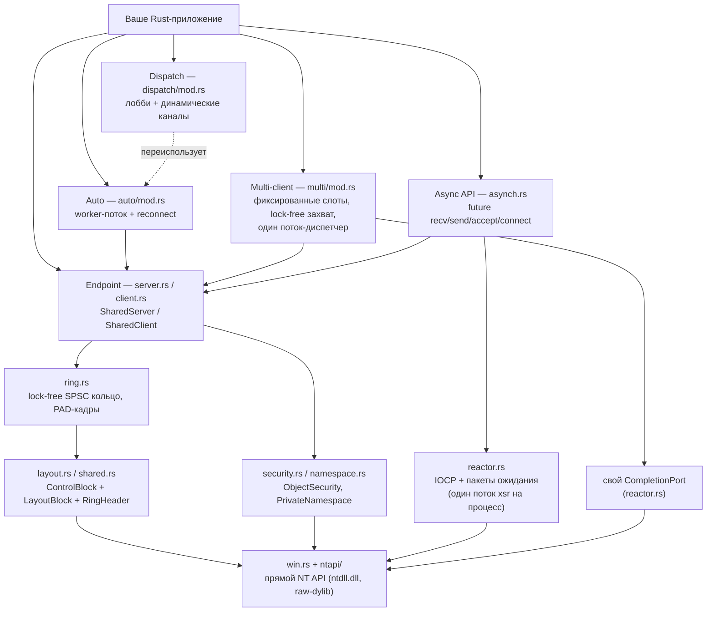
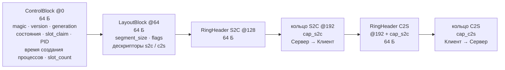
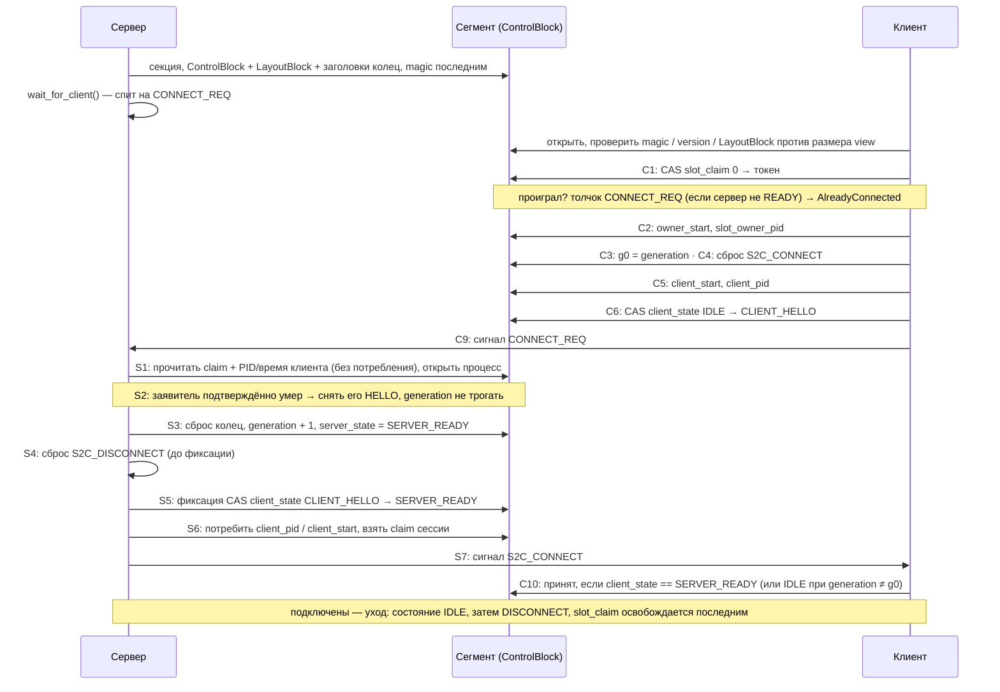
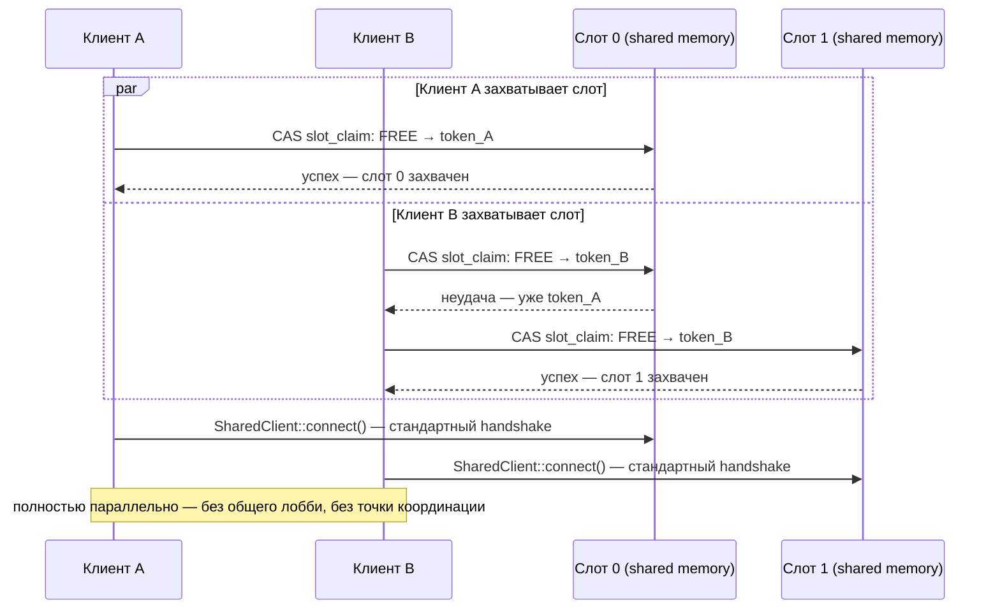

> **Предварительный C-backend (`feat/c-core`).** Временный feature `c-core`
> открывает `xshm::c_core` поверх единственного C-ядра xipc. Сейчас переносится
> Single-режим; это ещё не полный выпуск замены. API 0.10 ниже пока остаётся
> эталоном. Корректное владение важнее совместимости со старым API; по итогам
> перехода независимая Rust-реализация протокола будет удалена.
>
> Задайте `XIPC_SOURCE_DIR` — путь к исходникам `xhook/ipc`, затем выполните
> `cargo test --features c-core --test c_core -- --test-threads=1`.
> Требуются CMake 4 и MSVC. Альтернатива: `XIPC_SDK_PREFIX` (не обе переменные)
> для готового hosted Release SDK нужной архитектуры и CRT. Для статического
> CRT этого репозитория SDK собирается с
> `-DXIPC_CRT_FREE=OFF -DCMAKE_MSVC_RUNTIME_LIBRARY=MultiThreaded`.
> Раскладка C ABI, архитектура и CRT проверяются до линковки.

<div align="center">

# xShm

**Высокопроизводительный межпроцессный IPC через shared memory для Windows**

Двунаправленный обмен сообщениями через lock-free SPSC кольцевые буферы, поверх прямых вызовов NT API. Чистый Rust-крейт — без C/C++ FFI.

<p>
  
  
  
  
  
</p>

<p>
  <a href="README.md"></a>
  <a href="README.ru.md"></a>
</p>

</div>

---

## 🆕 Что нового в v0.10.0

> **Несовместимо:** новый формат разделяемой памяти `0x00020000`. Пиры 0.9 (и
> нативные пиры по контракту 0.9) отвергаются по версии —
> `ShmError::VersionMismatch`; обновляйте обе стороны. Полный список изменений
> API — таблица «Миграция с 0.9» в [`CHANGELOG.md`](CHANGELOG.md); контракт для
> нативных пиров — [`INTEROP.md`](INTEROP.md).

- ✅ **Раскладка канала по направлениям** — `RingConfig { capacity,
  max_messages, max_message_size }` на каждое направление, вместе —
  `ChannelLayout { server_to_client, client_to_server }`. Ёмкость — степень
  двойки от 4 КиБ до 1 ГиБ, сообщение — до `capacity / 2 − 8` байт (намного
  больше прежних 64 КиБ). Раскладку выбирает сервер и пишет в сегмент
  (`LayoutBlock`); клиент читает её оттуда и сверяет с фактическим размером
  отображения. `SharedServer::start_with(name, &ChannelConfig)`, поля `layout` в
  `AutoOptions`/`MultiOptions`, `channel_layout`/`lobby_layout` в
  `DispatchOptions`. Раскладка по умолчанию — как в 0.9 (2 × 2 МиБ, 500
  сообщений, 65 535 байт).
- ✅ **Безопасность объектов** — именованные объекты больше не создаются с NULL
  DACL: по умолчанию `ObjectSecurity::CurrentUser` (пользователь токена +
  SYSTEM), также `CurrentUserAllowLowIntegrity`, `Everyone` (поведение ≤ 0.9) и
  свой `Descriptor`. Отказ при открытии — `ShmError::AccessDenied`. См.
  [Безопасность объектов](#безопасность-объектов-010).
- ✅ **Частные пространства имён** — `PrivateNamespace` переносит каналы, лобби,
  слоты Multi и маяки в каталог по дескриптору границы: другие пользователи их
  не видят и не могут занять. См.
  [Частное пространство имён](#частное-пространство-имён-010).
- ✅ **Zero-copy** — кадр больше не разрывается концом кольца (остаток
  занимает PAD-кадр), payload всегда непрерывен: `send_with(len, |buf| ..)`
  заполняет сообщение на месте (безопасно), `unsafe receive_with(|msg| ..)`
  читает на месте (`ShmError::Overrun`, если писатель успел перезаписать); Auto
  может отдавать `on_message` срезом прямо из кольца —
  `unsafe AutoOptions::zero_copy_delivery`. См. [Zero-copy](#zero-copy-010).
- ✅ **Async API** — `accept_async`/`connect_async`/`recv_async`/`send_async` у
  `SharedServer`/`SharedClient`, без привязки к исполнителю (только
  `core::task`), ожидание ведёт один на процесс поток-реактор IOCP, а не поток
  на канал. См. [Async API](#async-api-010).
- ✅ **Адаптивный спин** — `SpinPolicy { iterations }` перепроверяет кольцо
  перед засыпанием (`poll_*_spin`, `wait_for_space_spin`, поля `spin` в
  опциях). По умолчанию выключен («ноль пробуждений в простое» сохраняется);
  с `--spin 2000` p50 круга 16 байт падает примерно на порядок (≈ 6,8 → 0,6 мкс на ненагруженной машине). См.
  [Спин](#спин-перед-ожиданием-010).
- ✅ **Multi-client на одном потоке** — сервер обслуживает все слоты (до 256)
  одним потоком-диспетчером на своём порту завершения вместо worker-а на
  каждые 21 слот. Дочитывание ушедшего клиента ограничено, паника колбэка
  изолирована в своём слоте (`on_error(Some(slot), WorkerPanicked)`).
- ✅ **Исключительная заявка single-client канала (рукопожатие ревизии 3)** —
  клиент берёт канал CAS-ом `slot_claim`; второй клиент сразу получает
  `ShmError::AlreadyConnected`, а не перетирает заявку первого. Заявку
  упавшего держателя снимает сервер (сразу при подтверждённой смерти или через
  `RESERVE_TIMEOUT` после толчка проигравшего клиента) — таймеров в простое
  по-прежнему нет. Доказательство — исчерпывающая модель двух клиентов и
  сервера (`handshake_model`, ≈1,9 млн состояний).
- ✅ **Допуск в Dispatch** — `DispatchHandler::admit` → `Admission::{Accept,
  AcceptWithLayout, Reject}` до создания канала; `max_clients` (64); протокол
  лобби строгий (неверная длина, хвостовые байты, невалидный UTF-8 —
  `Corrupted`).
- 🔒 **Защита** — личность пира, устойчивая к переиспользованию PID (рядом с
  каждым PID — время создания процесса), принимаются только секции
  `SEC_COMMIT`, каждое значение от пира проверяется по границам (фаззер
  `attach`, тесты враждебного пира), маяк помнит свой сервер
  (`<имя>_beacon_state`, `clear_if_stale` не опускает маяк живого сервера),
  `SharedServer`/`SharedClient` — `!Sync` (параллельные `&self`-вызовы гонялись
  на одной стороне SPSC-кольца).
- 🐛 **Исправлен потерянный сигнал `DATA`** — писатель решает по позициям
  кольца с перепроверкой, читатель подтверждает «пусто» после полного
  барьера; раньше сообщение могло лежать непрочитанным до следующего.

**Миграция с 0.9** — типичные правки:

```rust
use xshm::{AutoOptions, ChannelLayout, ClientRegistration, ObjectSecurity, RingConfig};

// 0.9: ClientRegistration { pid, revision, name }  (добавлено поле)
let registration = ClientRegistration::new(std::process::id(), 1, "my_app");

// 0.9: литералы опций без `..Default::default()` больше не собираются
let options = AutoOptions {
    // служба в сессии 0 <-> процесс пользователя через Global\: NULL DACL как в 0.9
    security: ObjectSecurity::Everyone,
    // по желанию: крупные снимки от сервера, короткие команды обратно
    layout: ChannelLayout {
        server_to_client: RingConfig::new(32 << 20).max_message_size(4 << 20),
        client_to_server: RingConfig::new(64 << 10),
    },
    ..Default::default()
};

// 0.9: xshm::MAX_MESSAGE_SIZE (теперь устаревший псевдоним значения по умолчанию)
// 0.10: лимит живого канала, например `server.free_space().max_message_size`
```

## Ранее в v0.9.0

- ✅ **Auto/Dispatch целиком по событиям** (breaking: `poll_timeout` теперь
  `Option<Duration>`, по умолчанию `None`) — каждый worker, поток лобби и поток
  ожидания подключения спит в ядре до события: данные, место, отключение,
  смерть пира, новая команда (`send`/`try_send`/`stop` будят worker безымянным
  событием) или остановка. Ноль пробуждений в простое; отправка больше не ждёт
  следующего тика опроса (50 мс). `Some(t)` — необязательный страховочный
  таймаут.
- ✅ **Multi-client по событиям** (breaking: `MultiOptions`/`MultiClientOptions::poll_timeout`
  теперь `Option<Duration>`, по умолчанию `None`; новое `MultiClientOptions::retry_delay`) —
  тика 50 мс больше нет. Worker-ы сервера (по одному на 21 слот) спят на `CONNECT_REQ` /
  `DISCONNECT` / `DATA` / handle процесса клиента / безымянном `wake` и просыпаются по
  таймауту только к ближайшему *дедлайну* (протухший захват слота, разовая проверка
  брошенного рукопожатия). Смерть клиента — по handle процесса
  (`on_client_disconnect_reason(PeerDied)`); клиент, не нашедший свободного слота,
  «толкает» сервер, и захват упавшего клиента снимается ровно на дедлайне. Новые
  методы по умолчанию `on_client_disconnect_reason` / `on_disconnect_reason`,
  `MultiServer::is_client_alive`. Тесты доказывают 0 пробуждений за секунду простоя.
- ✅ **`wait_for_space` без срезов** — одно ожидание в ядре на весь таймаут по
  `[SPACE, DISCONNECT, процесс пира]`; штатное отключение пира — `Err(NotConnected)`,
  а не ожидание до таймаута.
- ✅ **Лобби Dispatch сериализовано** — клиент держит именованный мьютекс `<лобби>_lock`
  всё рукопожатие с лобби (два одновременных клиента могли прочитать чужой ответ); имя
  канала наследует namespace лобби (`Global\<hex>`) — межсессионный Dispatch работает;
  `Beacon::open` отвергает подменённое автосбросное событие с тем же именем.
- ✅ **`Beacon` — событийное обнаружение сервера** — именованное
  событие-уведомление с ручным сбросом `<имя>_beacon`: сервер взводит его
  (`raise`) сразу после создания лобби и сбрасывает (`lower`) до остановки;
  клиенты спят в `wait()` / `wait_any()` и просыпаются все сразу — никаких
  попыток подключения, пока сервера нет. `open` создаёт или открывает (порядок
  запуска любой), `is_raised()` — проверка без ожидания. `Beacon::unnamed()` —
  безымянное событие того же вида (например, сигнал остановки рядом с маяком
  в `wait_any`; по имени его не открыть и не занять). `ProcessExit` держит
  handle процесса и срабатывает при его завершении;
  `xshm::wait_any(&[&dyn Waitable], timeout)` ждёт маяки и завершения
  процессов вместе. См. [Обнаружение сервера](#обнаружение-сервера).
- ✅ **Dispatch: надёжность** — `DispatchServer::start` создаёт лобби
  синхронно (занятое имя — ошибка, а не молчаливые повторы в фоне); клиент
  объявляется (`on_client_connect`) в worker-е своего канала **до** первого
  `on_message` (ранние сообщения раньше приходили от неизвестного клиента и
  терялись); сообщения, принятые до `disconnect_client`/`stop`, дописываются в
  кольцо, и пир дочитывает их до своего `on_disconnect` (прощальное сообщение
  с причиной теперь доходит); `stop()` будит все потоки событием, а не ждёт
  тика опроса или `channel_connect_timeout`; `DispatchClient::lobby_exists(name)`.
- ✅ **События места для отправителей** — `DispatchClientHandler::on_space_available()`
  и `DispatchHandler::on_space_available(client_id)` (по умолчанию ничего):
  отправитель без потерь, получивший `QueueFull`, спит до освобождения места
  пиром, а не в цикле со сном. Перед колбэком worker дописывает очередь в
  освободившееся место.
- 🐛 **Ревизия 2 (25.09.2026)** — клиент, отключённый сразу после
  рукопожатия (например, отказ из `on_client_connect`), получает прощание и
  `on_disconnect`: рукопожатие засчитывается по смене `generation`, даже если
  сервер уже `IDLE` (раньше клиент откатывался и вечно переподключался к
  исчезнувшему каналу). Рукопожатие фиксируется CAS-ами с обеих сторон
  (нет устаревшего `S2C_CONNECT` для следующего клиента); выделенный канал
  Dispatch не переподключается и после неудачного первого подключения;
  Multi `disconnect_client` держит claim слота, пока клиент не проснётся
  (раньше на одном кольце могли оказаться два клиента); `stop()`/Drop не
  ждут таймаута рукопожатия; `MultiServer::stop()` сигналит клиентам сразу;
  `DispatchServer::stop()` из колбэка обработчика больше не блокируется.
  Пир-видимые правила R15–R17 — [`INTEROP.md`](INTEROP.md).
- 🐛 Имена тестов маяка не были уникальны (`Instant::now().elapsed()` ≈ 0).

> **Нативные (C/C++) пиры:** раскладка памяти и объекты ядра каналов не изменились,
> но 0.9 больше не «лечит» пропущенные сигналы опросом раз в 50 мс. Что обязана
> сигналить совместимая реализация, новый объект `<имя>_beacon` и гарантии порядка
> Dispatch — в [INTEROP.md](INTEROP.md).

- ✅ **Хук старта рабочих потоков** — `xshm::set_thread_start_hook(Some(f))` на потоке:
  каждый рабочий поток, который библиотека создаст из него (worker-ы Auto/Dispatch/Multi,
  канал клиента `DispatchServer`, ожидание канала, отложенный `Drop`), первым делом зовёт
  `f()`; потоки, порождённые рабочими, наследуют хук. xshm-объекты других потоков не
  затрагиваются. `prof-shm` так делает свои транспортные потоки внутренними для учёта
  памяти профайлера. Только Rust API: на проводе ничего не меняется.

## Ранее в v0.8.0


- ✅ **Запись без потерь** — `try_send_to_client` / `try_send_to_server` / `try_send` / `try_send_to` никогда не затирают непрочитанное (`Err(QueueFull)` — кольцо не тронуто); `free_space()` — консервативная оценка места для писателя; `wait_for_space()` ждёт события `SPACE`. Раскладка совместима с 0.7.0 (`SHARED_VERSION` прежний).
- ✅ **Надёжная детекция смерти пира** — в handshake стороны обмениваются PID, и каждая держит открытый handle процесса другой; убитый/упавший пир замечается за ~1–5 мс (см. [Живость пира](#живость-пира)). Новый `DisconnectReason` (`Graceful` / `PeerDied` / `Local` / `Error`) через колбэки-методы по умолчанию `on_disconnect_reason` / `on_client_disconnect_reason`, аксессоры `is_peer_alive()` / `peer_pid()`, `ShmError::PeerDied` из `wait_for_space` / `poll_*`. Совместимо по wire-формату с пирами 0.7.0 / раннего 0.8.0 (за ними просто нет наблюдения).
- ✅ Константы кольца (`RING_CAPACITY`, `MAX_MESSAGES`, `MAX_MESSAGE_SIZE`, …) экспортируются из корня крейта.
- 🐛 Auto: `send` недопустимой длины больше не блокирует очередь навсегда — сообщение выбрасывается с `on_error`.

## Ранее в v0.7.0

- ✅ **Чистый Rust-крейт** (breaking) — весь слой C/C++ FFI удалён: `ffi.rs`, `multi/ffi.rs`, `dispatch/ffi.rs`, сборочный шаг `cbindgen`, сгенерированные заголовки `include/*.h` и crate-type `staticlib`. Крейт собирается только как `rlib` и потребляется из Rust; для нативных потребителей пишется отдельный синхронный проект на C23.
- ✅ **Ноль build-зависимостей** — `build.rs` теперь делает единственную вещь: `cargo:rustc-link-lib=ntdll`; `thiserror` остаётся единственной runtime-зависимостью
- ✅ **Edition 2024 / современный Rust** — `unsafe extern` для NT-импортов, if-let цепочки, strict provenance (`.addr()` / `without_provenance_mut`) вместо `as`-кастов между целыми и указателями, `MaybeUninit` + `spare_capacity_mut` вместо `set_len` до записи, политика линтов в манифесте с `undocumented_unsafe_blocks = "deny"`, `Debug` и `#[must_use]` по публичному API
- ✅ **Полный аудит** — `Global\` в имени канала наконец работает (межсессионный IPC был сломан), `Mapping::open` отвергает секции недостаточного размера, `MultiClient::is_connected()`/`DispatchClient::is_connected()` перестали врать после остановки, переполнение send-очереди сообщается через `on_overflow`, из worker-потоков убраны все `expect()`-паники

## Ранее в v0.6.0

- ✅ **Dispatch-режим** — пятый режим (`DispatchServer`/`DispatchClient`): одно лобби + динамический канал на каждого клиента, без фиксированного верхнего предела числа клиентов
- ✅ **Редизайн Multi-client** — центральный lobby-сегмент убран. Клиенты теперь конкурентно захватывают свободный слот через lock-free CAS на памяти самого слота — полностью параллельные подключения, без общей точки конкуренции
- ✅ **Хардненинг** — защита от torn-read при переполнении кольца, обнаружение мёртвых/брошенных слотов (liveness-проверка процесса-владельца), синхронный `stop()` (после возврата ни один callback уже не вызывается), ограниченные send-очереди повсюду
- ✅ **Чистка API** (breaking, pre-1.0) — убраны мёртвые поля, унифицированы имена между режимами (`poll_timeout`, `channel_name`), убран автогенерируемый префикс имени объекта — вызывающая сторона теперь полностью владеет видимым именем NT-объекта
- ✅ **Не требует прав администратора** — именованные объекты по умолчанию session-scoped; повышенные привилегии нужны только при явном использовании `Global\`

## Возможности

- Межпроцессный канал с двумя кольцевыми буферами (сервер→клиент и клиент→сервер), размер **по направлениям** (`ChannelLayout`, от 4 КиБ до 1 ГиБ каждое, по умолчанию 2 МиБ); раскладка самоописана в сегменте
- Lock-free SPSC-кольца: независимые чтение/запись, запись с вытеснением старейшего или без потерь (`try_send*`), защита от torn-read при переполнении (seqlock-копирование), кадры не разрываются концом кольца — zero-copy `send_with` / `receive_with`
- Синхронизация на событиях NT API для уведомлений о данных/месте/подключении — ноль пробуждений в простое; по желанию адаптивный спин (`SpinPolicy`)
- Async API без привязки к исполнителю поверх общего реактора IOCP
- Гарантия чистого старта: буферы сбрасываются при каждом новом подключении с отслеживанием generation; исключительная заявка single-client канала (`AlreadyConnected`)
- Безопасность объектов по политике создателя (`ObjectSecurity`, по умолчанию текущий пользователь + SYSTEM) и частные пространства имён (`PrivateNamespace`)
- Живость пира по handle процесса, сверенного по времени создания (переиспользованный PID не обманет)
- Трейты-обработчики вместо callback-структур: `AutoHandler`, `MultiHandler`, `MultiClientHandler`, `DispatchHandler`, `DispatchClientHandler`
- **Auto-режим**: фоновая обработка сообщений с callback'ами (`on_message`/`on_overflow`), автоматический reconnect
- **Multi-client режим**: один сервер обслуживает до `MAX_MULTI_CLIENTS` (256) клиентов через lock-free конкурентный захват слота, все слоты — на одном потоке-диспетчере
- **Dispatch-режим**: одно лобби + динамический канал на клиента, управление допуском (`admit`, `max_clients`)
- **Прямой NT API**: импорт `ntdll.dll` через `raw-dylib` (без `ntdll.lib` и `GetProcAddress`), без внешних зависимостей
- **Статический CRT**: CRT линкуется статически, без зависимости от runtime DLL

## Архитектура



## Layout Shared Memory

Каждый канал — один Named (или anonymous) Section, замапленный в адресное пространство обоих процессов:



Формат `SHARED_VERSION = 0x00020000`. Размер сегмента —
`256 + cap_s2c + cap_c2s` (4 194 560 байт при 2 × 2 МиБ по умолчанию,
`ChannelLayout::segment_size()`). Смещения колец записаны в `LayoutBlock` явно
(дескриптор: `offset`, `capacity`, `max_messages`, `max_message_size`), клиент
проверяет только границы — сервер вправе разложить кольца иначе. `magic`
публикуется последним.

Кадр — `u32 len` + `u32 flags` + payload, дополненный до 8 байт. Кадр никогда
не пересекает конец кольца: если не помещается, писатель занимает остаток
PAD-кадром (`flags = FRAME_PAD`) и кладёт кадр с индекса 0, публикуя оба одной
записью `write_pos`, — отсюда предел сообщения `capacity / 2 − 8`:

```text
 индекс 0                                              capacity
 |  кадр N+1 (len, 0, payload...)  | ... свободно ... | кадр N | PAD (len = остаток − 8) |
                                                               ^ write_pos до PAD
```

## Как устанавливается соединение

Рукопожатие ревизии 3 (нормативные шаги C1–C10 / S1–S7 — `INTEROP.md` §d.2,
правила R15, R16, R18):



Клиент, у которого истёк таймаут, отзывает заявку `CAS CLIENT_HELLO → IDLE` и
освобождает claim; проигранный CAS при сменившемся `generation` означает, что
его всё-таки приняли (он дочитывает кольцо и уходит).

## Выбор режима

| | Single-client | Auto | Multi-client | Dispatch |
|---|:---:|:---:|:---:|:---:|
| Клиентов на сервер | 1 | 1 | до 256 (фикс. слоты) | не ограничено |
| Потоки | нет — управляется вызывающим (или async future на общем реакторе) | фоновый worker | один поток-диспетчер на все слоты (сервер), worker на клиента | worker лобби + worker на клиента |
| Reconnect | вручную | автоматически | автоматически (re-claim) | автоматически |
| Стоимость подключения | 1 handshake | 1 handshake | 1 CAS + 1 handshake | 1 round-trip к лобби + 1 handshake |
| Когда использовать | простейший парный IPC, интеграция с драйвером | один пир, нужна устойчивость | известный/ограниченный парк клиентов | размер парка заранее неизвестен |

## Именование каналов

Имя, переданное в конструктор, становится именем kernel-объекта как есть, а
namespace выбирается по префиксу:

| Что передали | Объект-секция | Namespace |
|--------------|---------------|-----------|
| `"Chan"` | `Local\Chan` | session-local |
| `"Local\Chan"` | `Local\Chan` | session-local (префикс не удваивается) |
| `"Global\Chan"` | `Global\Chan` | глобальный — нужен для IPC между сессиями (служба в сессии 0 ↔ процесс на десктопе) |
| `"\BaseNamedObjects\Chan"` | как есть | готовый NT-путь |

События канала всегда попадают в тот же namespace, что и секция.

## Безопасность объектов (0.10)

**NULL DACL больше не по умолчанию.** Каждый именованный объект, который
создаёт xshm (секция канала и её 7 событий, слоты Multi, лобби Dispatch, его
мьютекс `<лобби>_lock` и каналы клиентов, маяк и `<имя>_beacon_state`),
получает дескриптор безопасности, выбранный **создателем** (`ObjectSecurity`);
открывающая сторона дескриптор не передаёт и проверяется по DACL создателя.
Отказ при открытии — `ShmError::AccessDenied`.

| Политика | DACL / SACL | Для чего |
|----------|-------------|----------|
| `ObjectSecurity::CurrentUser` (по умолчанию) | SID пользователя токена процесса + SYSTEM (`S-1-5-18`), `GENERIC_ALL` | пиры одного пользователя |
| `ObjectSecurity::CurrentUserAllowLowIntegrity` | то же + метка Low `S:(ML;;NW;;;LW)` | песочницы (Low IL) того же пользователя |
| `ObjectSecurity::Everyone` | NULL DACL (поведение ≤ 0.9) | служба SYSTEM ↔ пользователь через `Global\` без общей группы |
| `ObjectSecurity::Descriptor(bytes)` | свой self-relative дескриптор (проверяется) | всё остальное (например, SYSTEM + `Users`, SID AppContainer) |

```rust
use xshm::{ChannelConfig, DispatchOptions, ObjectSecurity, SharedServer};

// Служба в сессии 0 и процессы других пользователей на десктопе:
let config = ChannelConfig::default().security(ObjectSecurity::Everyone);
let server = SharedServer::start_with("Global\\MyService", &config)?;
// Auto / Multi / Dispatch: поле `security` их опций (каналы Dispatch и
// мьютекс лобби наследуют `DispatchOptions::security`);
// маяк: `Beacon::open_with(name, &policy)`.
let options = DispatchOptions { security: ObjectSecurity::Everyone, ..Default::default() };
```

**Миграция с 0.9**: `Global\`-канал служба SYSTEM ↔ процесс пользователя
работал с NULL DACL; с политикой по умолчанию пользователь получает
`AccessDenied`, если объекты создаёт служба. Создающей стороне нужна
`ObjectSecurity::Everyone` (или свой `Descriptor`).

## Частное пространство имён (0.10)

DACL не даёт другим пользователям *открыть* объекты, но в общем
`\BaseNamedObjects` любой по-прежнему *видит* имена и может занять их заранее.
`PrivateNamespace` переносит канал, лобби, слоты Multi или маяк в каталог
объектов ядра, который ищется не по имени, а по **дескриптору границы** — имя
границы + SID пользователя процесса (+ метка Low для
`CurrentUserAllowLowIntegrity`). Открыть или создать его может только процесс
того же пользователя; для остальных объектов просто нет
(`STATUS_OBJECT_NAME_NOT_FOUND`).

```rust
use std::sync::Arc;
use std::time::Duration;
use xshm::{ChannelConfig, ObjectSecurity, PrivateNamespace, SharedClient, SharedServer};

// Обе стороны вызывают open_or_create с одной границей и одной политикой.
let ns = PrivateNamespace::open_or_create("MyApp", "myapp", &ObjectSecurity::default())?;
// Имена внутри — относительные: без `Local\` / `Global\` (иначе `InvalidConfig`).
let server = SharedServer::start_with("Chan", &ChannelConfig::default().namespace(Arc::clone(&ns)))?;

// Процесс клиента:
let ns = PrivateNamespace::open_or_create("MyApp", "myapp", &ObjectSecurity::default())?;
let client = SharedClient::connect_in(&ns, "Chan", Duration::from_secs(2))?;
// Auto / Multi / Dispatch: `namespace: Some(ns)` в их опциях (каналы Dispatch —
// в пространстве лобби); маяк: `Beacon::open_in(&ns, name, &policy)`.
```

Пространство живёт, пока хоть один процесс держит его handle; xshm его не
удаляет (`NtDeletePrivateNamespace`), поэтому перезапущенный сервер и
переподключающийся клиент встречаются в одном и том же. `alias` — только для
диагностики (как `lpAliasPrefix` у Win32). Процессы того же пользователя
границу проходят — это не изоляция внутри одной учётной записи. Между
пользователями (служба SYSTEM ↔ пользователь) общее пространство невозможно
(разные SID) — там `Global\` + `ObjectSecurity`.

## Требования

- Windows 10/11
- Rust 1.99+ (stable) — edition 2024, `rust-version = "1.99"` в манифесте
- Тулчейн MSVC (MinGW-таргеты убраны в 0.7.0 вместе с C ABI)
- **Права администратора НЕ требуются** — именованные kernel-объекты session-scoped (префикс `Local\` → `\Sessions\<SessionId>\BaseNamedObjects\`). Повышенные права нужны только при явном использовании префикса `Global\`

## Зависимости

**Минимум зависимостей** — только `thiserror` для обработки ошибок:

```toml
[dependencies]
thiserror = "2"
```

Вызовы NT API импортируются напрямую из `ntdll.dll` через
`#[link(name = "ntdll", kind = "raw-dylib")]`:
- Без `ntdll.lib` из Windows SDK
- Без зависимости от SSN
- Без `GetProcAddress` в рантайме

## Сборка

Подключается как path- или git-зависимость:

```toml
[dependencies]
xshm = { path = "../xshm" }
```

```bash
cargo build --release                                   # x64 MSVC (по умолчанию)
cargo build --release --target i686-pc-windows-msvc     # x86 MSVC

# Запуск тестов
cargo test -- --test-threads=1   # последовательно: тесты делят пространство имён объектов
```

Крейт собирается только как `rlib`. `build.rs` выдаёт только `rerun-if-changed`;
импорты `ntdll` — `raw-dylib`, поэтому библиотека импорта не нужна и при сборке
бинаря потребителя.

```bash
cargo run --release --example bench -- throughput 4096 5          # SharedServer -> SharedClient
cargo run --release --example bench -- latency 16 5 --spin 2000    # RTT ping-pong со спином
cargo run --release --example bench -- throughput 1048576 5 --zero-copy
```

## Использование

```rust
use std::thread;
use std::time::Duration;
use xshm::{SharedClient, SharedServer};

fn main() -> xshm::Result<()> {
    let name = "ExampleChannel";

    let server_thread = thread::spawn({
        let name = name.to_owned();
        move || -> xshm::Result<()> {
            let mut server = SharedServer::start(&name)?;
            server.wait_for_client(Some(Duration::from_secs(5)))?;
            server.send_to_client(b"ping")?;
            let mut buffer = Vec::new();
            let len = server.receive_from_client(&mut buffer)?;
            println!("client -> server: {:?}", &buffer[..len]);
            Ok(())
        }
    });

    thread::sleep(Duration::from_millis(50));

    let client = SharedClient::connect(name, Duration::from_secs(5))?;
    let mut buffer = Vec::new();
    let len = client.receive_from_server(&mut buffer)?;
    println!("server -> client: {:?}", &buffer[..len]);
    client.send_to_server(b"pong")?;

    server_thread.join().unwrap()?;
    Ok(())
}
```

### Auto-режим

```rust
use std::sync::Arc;
use xshm::{AutoClient, AutoHandler, AutoOptions, AutoServer, ChannelKind, Result};

struct Logger;

impl AutoHandler for Logger {
    fn on_message(&self, dir: ChannelKind, payload: &[u8]) {
        println!("[{:?}] {}", dir, String::from_utf8_lossy(payload));
    }
}

fn main() -> Result<()> {
    let handler = Arc::new(Logger);
    let server = AutoServer::start("AutoChannel", handler.clone(), AutoOptions::default())?;
    let client = AutoClient::connect("AutoChannel", handler, AutoOptions::default())?;

    client.send(b"hello")?;
    server.send(b"world")?;

    std::thread::sleep(std::time::Duration::from_millis(100));
    Ok(())
}
```

### Multi-client режим

Фиксированный пул слотов (по умолчанию 20, жёсткий предел 256; 256 слотов ×
раскладка по умолчанию 2 × 2 МиБ ≈ 1 ГиБ секций — для больших `max_clients`
задавайте маленький `MultiOptions::layout`). Клиенты конкурентно
захватывают свободный слот через lock-free CAS — без центрального лобби,
без раунда согласования:



```rust
use std::sync::Arc;
use xshm::multi::{MultiServer, MultiClient, MultiHandler, MultiClientHandler, MultiOptions, MultiClientOptions};
use xshm::Result;

struct ServerHandler;

impl MultiHandler for ServerHandler {
    fn on_client_connect(&self, client_id: u32) {
        println!("Client {} connected", client_id);
    }
    fn on_client_disconnect(&self, client_id: u32) {
        println!("Client {} disconnected", client_id);
    }
    fn on_message(&self, client_id: u32, data: &[u8]) {
        println!("Message from client {}: {:?}", client_id, data);
    }
}

struct ClientHandler;

impl MultiClientHandler for ClientHandler {
    fn on_connect(&self, slot_id: u32) {
        println!("Claimed slot {}", slot_id);
    }
    fn on_disconnect(&self) {
        println!("Disconnected");
    }
    fn on_message(&self, data: &[u8]) {
        println!("Received: {:?}", data);
    }
}

fn main() -> Result<()> {
    // Запуск multi-client сервера (по умолчанию 20 слотов)
    let server = MultiServer::start("MyService", Arc::new(ServerHandler), MultiOptions::default())?;

    // Каждый клиент сам захватывает свободный слот (base name общий для всех)
    let client1 = MultiClient::connect("MyService", Arc::new(ClientHandler), MultiClientOptions::default())?;
    let client2 = MultiClient::connect("MyService", Arc::new(ClientHandler), MultiClientOptions::default())?;
    let client3 = MultiClient::connect("MyService", Arc::new(ClientHandler), MultiClientOptions::default())?;

    println!("Client 1 slot: {}", client1.slot_id());
    println!("Client 2 slot: {}", client2.slot_id());
    println!("Client 3 slot: {}", client3.slot_id());

    // Отправка конкретному клиенту по slot_id
    server.send_to(0, b"Hello client 0")?;

    // Broadcast всем подключённым
    server.broadcast(b"Hello everyone")?;

    // Клиент отправляет серверу
    client1.send(b"Hello server")?;

    std::thread::sleep(std::time::Duration::from_millis(100));
    Ok(())
}
```

### Dispatch-режим

Одно лобби + динамический канал на базе `AutoServer` для каждого клиента.
В отличие от Multi-client, здесь нет фиксированного числа слотов — выбирайте
этот режим, когда число одновременных клиентов заранее не известно.

```rust
use std::sync::Arc;
use xshm::{
    ClientRegistration, DispatchClient, DispatchClientHandler, DispatchClientOptions,
    DispatchHandler, DispatchOptions, DispatchServer, Result,
};

struct ServerHandler;

impl DispatchHandler for ServerHandler {
    fn on_client_connect(&self, client_id: u32, info: &ClientRegistration) {
        println!("Client {} connected (pid {}, {})", client_id, info.pid, info.name);
    }
    fn on_client_disconnect(&self, client_id: u32) {
        println!("Client {} disconnected", client_id);
    }
    fn on_message(&self, client_id: u32, data: &[u8]) {
        println!("From {}: {:?}", client_id, data);
    }
}

struct ClientHandler;

impl DispatchClientHandler for ClientHandler {
    fn on_connect(&self, client_id: u32, channel_name: &str) {
        println!("Registered as client {} on channel {}", client_id, channel_name);
    }
    fn on_disconnect(&self) {
        println!("Disconnected");
    }
    fn on_message(&self, data: &[u8]) {
        println!("Received: {:?}", data);
    }
}

fn main() -> Result<()> {
    let server = DispatchServer::start("MyService", Arc::new(ServerHandler), DispatchOptions::default())?;

    let registration = ClientRegistration::new(std::process::id(), 1, "my_app");
    let client = DispatchClient::connect(
        "MyService",
        registration,
        Arc::new(ClientHandler),
        DispatchClientOptions::default(),
    )?;

    client.send(b"hello")?;
    server.broadcast(b"hello everyone")?;

    std::thread::sleep(std::time::Duration::from_millis(100));
    Ok(())
}
```

### Запись без потерь (backpressure)

По умолчанию все пути отправки при заполненном кольце вытесняют самые старые
непрочитанные сообщения. Если читатель обязан увидеть *каждое* сообщение
(например, поток профайлера), используйте варианты без перезаписи:

| Режим | Отправка без перезаписи | Свободное место |
|-------|-------------------------|-----------------|
| Single-client | `SharedServer::try_send_to_client`, `SharedClient::try_send_to_server` | `free_space()`, `wait_for_space(len, timeout)` |
| Auto | `AutoServer::try_send`, `AutoClient::try_send` | `free_space()` |
| Dispatch | `DispatchClient::try_send`, `DispatchServer::try_send_to` | `DispatchClient::free_space()`, `DispatchServer::free_space(id)` |
| Multi-client | `MultiServer::try_send_to` | `MultiServer::free_space(id)` |

Семантика:

- Сообщение либо **целиком** ложится в свободное место, либо отклоняется с
  `ShmError::QueueFull`; непрочитанные данные не трогаются никогда (`overwritten` всегда 0).
  Атомарность та же, что у обычной отправки: читатель видит сообщение целиком или не видит вовсе.
- `FreeSpace` (`bytes`, `max_frame`, `messages`, `max_message_size`; `fits(len)`,
  `max_payload()`), снятый на стороне писателя, — **нижняя граница**: если `fits(n)`,
  следующий `try_send*` длины `n` пройдёт. Сообщение занимает `frame_size(len)` = заголовок
  8 байт + payload с округлением до 8, плюс PAD-кадр, если не помещается до конца кольца, —
  `fits` решает по `max_frame` (наибольший кадр, помещающийся непрерывно прямо сейчас), а не
  по `bytes`. Лимиты — по направлениям (`RingConfig`, по умолчанию 500 сообщений / 2 МиБ);
  сообщение длины `max_message_size` (≤ `capacity / 2 − 8`) всегда помещается в пустое кольцо.
- `wait_for_space` спит на событии `SPACE` канала: читатель будит писателя, только когда места
  стало достаточно. С 0.9 это одно ожидание в ядре по `[SPACE, DISCONNECT, процесс пира]`
  (без срезов по 50 мс): мёртвый читатель — `Err(PeerDied)`, штатное отключение —
  `Err(NotConnected)`. Читатель 0.7 будит только опустошив кольцо; упавший читатель без обмена
  PID не будит ничем — задавайте таймаут. Anonymous-сервер опрашивает раз в 1 мс.
- Auto/Dispatch сообщают об освободившемся месте событием: `AutoHandler::on_space_available`,
  `DispatchClientHandler::on_space_available()`, `DispatchHandler::on_space_available(id)` —
  отправитель, получивший `QueueFull`, ждёт его, а не спит в цикле.
- Auto/Dispatch асинхронны: `try_send` возвращает `QueueFull`, когда `max_send_queue` принятых
  сообщений ещё ждут места в кольце; принятые lossless-сообщения никогда не вытесняются и пишутся
  путём без перезаписи. Гарантия действует в пределах одного подключения (переподключение
  сбрасывает кольца). Не смешивайте `send` и `try_send` на канале, который обязан быть без потерь:
  перезаписывающий `send` может вытеснить из кольца более ранние сообщения.
- Писатель на направление -- по-прежнему один (SPSC).

```rust
use std::time::Duration;
use xshm::{SharedServer, ShmError};

fn stream(server: &SharedServer, blocks: &[Vec<u8>]) -> xshm::Result<()> {
    for block in blocks {
        loop {
            match server.try_send_to_client(block) {
                Ok(_) => break,
                Err(ShmError::QueueFull) => {
                    if !server.wait_for_space(block.len(), Some(Duration::from_secs(3)))? {
                        return Err(ShmError::Timeout); // читатель завис или умер
                    }
                }
                Err(err) => return Err(err),
            }
        }
    }
    Ok(())
}
```

Заявка на пробуждение живёт в `RingHeader::space_waiter`: сколько свободных байт
нужно ждущему писателю (кадр и возможный PAD); читатель, освободивший достаточно
места, снимает заявку и сигналит `SPACE`.

### Async API (0.10)

У `SharedServer` и `SharedClient` есть async-методы, не привязанные к
исполнителю: только `core::task`, xshm не зависит ни от tokio, ни от другого
runtime. Объекты ядра ждёт один поток реактора IOCP на процесс, а не поток на
канал; ожидающий future не опрашивается, пока не придёт сигнал.

| Сервер | Клиент | Чего ждёт |
|--------|--------|-----------|
| `accept_async()` | `SharedClient::connect_async(name)` | рукопожатия (протокол тот же, что у `wait_for_client`/`connect`) |
| `recv_async(&mut buf)` | `recv_async(&mut buf)` | сообщения (`Ok(len)`) |
| `send_async(data)` | `send_async(data)` | места, затем пишет **без перезаписи** |

- Пир отключился — `Err(NotConnected)`, процесс пира умер —
  `Err(PeerDied)`; `recv_async` сообщает их только после дочитанного кольца
  и затем отмечает сторону неподключённой (сервер может снова
  `accept_async`).
- Встроенных таймаутов нет: future бросают (например,
  `tokio::time::timeout`). Бросать можно в любой момент — регистрации
  снимаются, потреблённый сигнал возвращается событию, брошенный
  `connect_async` отзывает `CLIENT_HELLO` (или уходит штатно, если сервер
  уже принял заявку).
- Методы берут `&mut self`, поэтому future — `Send` (`tokio::spawn`
  работает). *Одновременные* приём и отправка одной стороны требуют
  разделения: `Mutex` или задача-владелец, которой команды идут через канал.
- Anonymous-сервер поддерживает те же async-ожидания: у него всегда есть
  семь безымянных событий. При подключении в частном пространстве имён
  используйте `SharedClient::connect_async_in(Arc::clone(&ns), name)`;
  future держит пространство до своего уничтожения, включая время после `Ready`.

```rust,ignore
// Пример с tokio (xshm от него не зависит).
use std::time::Duration;
use xshm::{SharedClient, SharedServer};

#[tokio::main]
async fn main() -> xshm::Result<()> {
    let mut server = SharedServer::start("MyAsyncChannel")?;
    let client_task = tokio::spawn(async {
        let mut client = SharedClient::connect_async("MyAsyncChannel").await?;
        client.send_async(b"ping").await?;
        let mut buf = Vec::new();
        let len = client.recv_async(&mut buf).await?;
        assert_eq!(&buf[..len], b"pong");
        xshm::Result::Ok(())
    });

    tokio::time::timeout(Duration::from_secs(5), server.accept_async())
        .await
        .map_err(|_| xshm::ShmError::Timeout)??;
    let mut buf = Vec::new();
    let len = server.recv_async(&mut buf).await?;
    assert_eq!(&buf[..len], b"ping");
    server.send_async(b"pong").await?;

    client_task.await.expect("client task")?;
    Ok(())
}
```

### Zero-copy (0.10)

Кадры не пересекают конец кольца (PAD-кадры, см.
[Layout Shared Memory](#layout-shared-memory)), поэтому payload — один
непрерывный срез в разделяемой памяти:

```rust
use xshm::{SharedClient, SharedServer};

fn send_in_place(server: &mut SharedServer, frame: &[u8]) -> xshm::Result<()> {
    // Запись без перезаписи (как try_send_to_client): срез заполняется прямо в кольце.
    server.send_with(frame.len(), |buf| buf.copy_from_slice(frame))?;
    Ok(())
}

fn checksum_in_place(client: &mut SharedClient) -> xshm::Result<u32> {
    // SAFETY (контракт вызывающего): сервер доверенный и пишет это направление
    // без перезаписи (try_send*/send_with/wait_for_space) — срез во время
    // замыкания никто не меняет.
    unsafe { client.receive_with(|msg| msg.iter().map(|&b| u32::from(b)).sum()) }
}
```

- `send_with` безопасен: срез — ещё не опубликованная часть кольца.
- `receive_with` — `unsafe`: срез указывает в память, которую может писать другой
  процесс. Перезапись, замеченная после замыкания, отбрасывает результат и даёт
  `ShmError::Overrun` (защита в глубину, а не гарантия). Для недоверенных пиров —
  копирующие `receive_from_*`.
- Оба берут `&mut self`: вложенная или параллельная вторая запись/чтение того же
  направления не компилируется.
- Auto по умолчанию копирует; `unsafe { AutoOptions::default().zero_copy_delivery() }`
  отдаёт `on_message` срез прямо из кольца с тем же контрактом.
- Максимальное сообщение — `capacity / 2 − 8` (`max_payload_for(capacity)`).

### Спин перед ожиданием (0.10)

`SpinPolicy { iterations }` перепроверяет кольцо по позициям до `iterations` раз
(`std::hint::spin_loop` между проверками), прежде чем уснуть в ядре. Бюджет —
один на засыпание: простаивающий поток отспинивает его один раз и спит без
таймаута — «ноль пробуждений в простое» сохраняется. За удачным спином всегда
идёт проверка событий с нулевым таймаутом: `DISCONNECT`, `SPACE` и смерть пира
по-прежнему замечаются.

```rust
use std::time::Duration;
use xshm::{AutoOptions, SharedClient, SpinPolicy};

fn poll_fast(client: &mut SharedClient) -> xshm::Result<bool> {
    client.poll_server_spin(Some(Duration::from_millis(10)), SpinPolicy::new(2000))
}

let options = AutoOptions { spin: SpinPolicy::new(2000), ..Default::default() };
```

Также `poll_client_spin`, `wait_for_space_spin` и поля `spin` в `MultiOptions`,
`MultiClientOptions`, `DispatchOptions`, `DispatchClientOptions` (только каналы
клиентов, лобби не спинит). `SpinPolicy::NONE` (по умолчанию) — поведение 0.9.
Цена — занятое ядро CPU во время спина. Замер на своей машине:
`cargo run --release --example bench -- latency 16 5 --spin 2000`.

### Живость пира

Штатное отключение сигналится событием `DISCONNECT`, но упавший или убитый
процесс не сигналит ничего. С 0.8 обе стороны узнают PID пира в handshake и
**держат открытый handle его процесса** (`SYNCHRONIZE`) всё время соединения.
Пока handle открыт, объект-процесс не удаляется ядром и при завершении процесса
становится сигнальным -- смерть видна надёжно, а переиспользование PID не
обманывает (повторное открытие по PID не отличает «процесса нет» от «нет прав»).

| Режим | Как видна смерть пира |
|-------|-----------------------|
| Single-client | `poll_client` / `poll_server` / `wait_for_space` сразу возвращают `Err(ShmError::PeerDied)`; `is_peer_alive() -> Option<bool>`, `peer_pid()` |
| Auto | handle процесса пира лежит в наборе ожидания worker-а → `AutoHandler::on_disconnect_reason(DisconnectReason::PeerDied)`; `is_peer_alive()`, `peer_pid()` |
| Dispatch | `DispatchHandler::on_client_disconnect_reason(id, PeerDied)`, `DispatchClientHandler::on_disconnect_reason(PeerDied)`; `DispatchServer::is_client_alive(id)`, `DispatchClient::{is_peer_alive, server_pid, disconnect_reason}` |
| Multi-client | handle процесса клиента привязан к порту завершения диспетчера сервера → `MultiHandler::on_client_disconnect_reason(id, PeerDied)`, слот освобождается; `MultiServer::is_client_alive(id)`; клиент видит смерть сервера → `MultiClientHandler::on_disconnect_reason(PeerDied)` |

- Новые колбэки -- **методы по умолчанию**, которые вызывают `on_disconnect` /
  `on_client_disconnect`, поэтому существующие обработчики работают как раньше.
  Библиотека вызывает только вариант `*_reason`.
- Всё, что пир успел записать в кольцо до смерти, доставляется **до** сообщения
  о `PeerDied`.
- `is_peer_alive()` возвращает `None` («неизвестно»), если пир старой версии (PID в
  handshake не передан) или его процесс не удалось открыть (например, служба в
  другой сессии без прав). Такие соединения ведут себя в точности как в 0.7.
- Замер на Windows 11 (`tests/peer_death.rs`, `TerminateProcess` пира): 1–5 мс от
  убийства до колбэка / ошибки во всех режимах.

Протокол: сервер при создании пишет свой PID в `ControlBlock::server_pid` (и время
создания своего процесса — в `server_start_lo/hi`); клиент до `CLIENT_HELLO` пишет
время создания и PID в `client_start_lo/hi` и `client_pid`, сервер потребляет их
после фиксации рукопожатия (ревизия 3, шаг S6). Наблюдатель открывает процесс по PID
и сверяет время создания: другое время — PID переиспользован, это не пир. PID
процесса, уже мёртвого на момент handshake, игнорируется.

### Обнаружение сервера

Именованные серверы single-client, Auto, Multi и Dispatch сами поднимают
маяк после публикации своих объектов и опускают его до закрытия.
Маяк создаётся по возможности: его ошибка не запрещает запуск сервера,
состояние доступно через `presence()`. Auto/Multi-клиенты ждут сервер по
событиям; `discovery_fallback` (по умолчанию 10 с, `None` — только события)
страхует отсутствие маяка, его подмену и старых нативных пиров. Этот резерв
работает вне подключения; подключённый простой не создаёт пробуждений.

Для синхронного клиента есть `SharedClient::wait_for_server(name, timeout)`
и варианты `_in`/`_with`. Занятый канал ожидается через
`SharedClient::wait_connectable(name, timeout)` (также `_in`/`_with`):
`Ok(true)` означает, что claim был свободен; метод его не захватывает,
поэтому проигравший следующую гонку `connect` ждёт снова. Освобождающие
стороны обязаны уведомлять `_free` (INTEROP R20); без этого ожидание
ограничено страховкой. Multi использует общий маяк `<база>_multi_beacon`
и уведомление `<база>_multi_free`; имя обычного канала `<база>_multi`
совпадает с этой базой, поэтому такие имена нельзя совмещать.

Клиенту, который ждёт сервер (например, профайлер ждёт свой вьюер), незачем
его опрашивать. `Beacon` — именованное событие с ручным сбросом:

```rust
use xshm::{Beacon, DispatchClient};

// Клиент: спать, пока не появится сервер или не попросят остановиться.
let lobby = Beacon::open("MyService")?;
let stop = Beacon::unnamed()?; // взводит наш же путь остановки
let mut retry_now = false;
loop {
    if !retry_now && Beacon::wait_any(&[&stop, &lobby], None)? != Some(1) {
        break; // остановка
    }
    retry_now = false;
    match DispatchClient::connect("MyService", registration(), handler(), Default::default()) {
        Ok(client) => { /* работа, пока канал жив */ }
        Err(_) if !DispatchClient::lobby_exists("MyService") => {
            // Маяк взведён, лобби нет: сервер, возможно, упал. Клиент НИКОГДА
            // не вызывает `lower()` — `clear_if_stale` сбрасывает маяк, только
            // если процесс взводившего сервера завершился, и возвращает его,
            // если тем временем маяк взвёл новый сервер (поколение маяка, 0.10).
            if lobby.clear_if_stale()? {
                retry_now = DispatchClient::lobby_exists("MyService");
            } else {
                /* процесс сервера жив: отступ (прерываемый `stop`) */
            }
        }
        Err(_) => { /* временная ошибка: отступ (прерываемый `stop`) */ }
    }
}
```

Порядок сервера: сначала лобби (`DispatchServer::start` синхронный и сам
поднимает маяк); повторный ручной `raise()` безвреден. При остановке —
сначала `lower()`, потом закрытие объектов. Клиенты
`raise`/`lower` именованного маяка не вызывают: `raise` записывает
вызывающего как сервер в `<имя>_beacon_state`.
`ProcessExit::open(pid)` вместе с `xshm::wait_any` позволяет клиенту, которому
сервер отказал, спать до завершения процесса этого сервера — тоже без опроса.

## Константы

Реэкспортированы из корня крейта. Размеры колец — у каждого канала и направления
свои (`RingConfig`); значения `DEFAULT_*` — то, что берут `RingConfig::DEFAULT` /
`ChannelLayout::DEFAULT`. `RING_CAPACITY`, `MAX_MESSAGES` и `MAX_MESSAGE_SIZE`
остались `#[deprecated]`-псевдонимами значений по умолчанию; `MESSAGE_HEADER_SIZE`
удалён (используйте `frame_size(len)`).

| Константа | Значение | Описание |
|-----------|----------|----------|
| `SHARED_VERSION` | `0x00020000` | Формат разделяемой памяти (иначе `VersionMismatch`) |
| `DEFAULT_RING_CAPACITY` | 2 МиБ | Размер кольца по умолчанию на направление |
| `MIN_RING_CAPACITY` / `MAX_RING_CAPACITY` | 4 КиБ / 1 ГиБ | Диапазон ёмкости кольца (степень двойки) |
| `DEFAULT_MAX_MESSAGES` | 500 | Лимит непрочитанных сообщений в кольце по умолчанию |
| `DEFAULT_MAX_MESSAGE_SIZE` | 65 535 | Максимальный payload по умолчанию; жёсткий предел — `max_payload_for(capacity)` = `capacity / 2 − 8` |
| `MIN_MESSAGE_SIZE` | 1 | Минимальный payload (байт) |
| `FRAME_HEADER_SIZE` / `FRAME_ALIGN` | 8 / 8 | Заголовок кадра (`u32 len` + `u32 flags`) и выравнивание кадров |
| `FRAME_PAD` | 1 | Бит `flags` PAD-кадра |
| `RECOUNT_MAX` | 64 | До этого `max_messages` писатель пересчитывает кадры (лимит точный); выше кольцо может кратковременно держать `max_messages + 1` |
| `DEFAULT_LOBBY_LAYOUT` | 2 × 16 КиБ, 16 сообщ., 1 КиБ | Раскладка лобби Dispatch по умолчанию |
| `multi::DEFAULT_MAX_CLIENTS` | 20 | Число слотов `MultiServer` по умолчанию |
| `multi::MAX_MULTI_CLIENTS` | 256 | Жёсткий предел `MultiServer`; его задаёт цена перебора (клиент перебирает слоты `0..256` до первого отсутствующего; сервер ещё пишет `slot_count` в каждый слот как подсказку — перебор клиенты по ней не ограничивают); все слоты обслуживает один поток-диспетчер |

## Event Handles для kernel-драйверов

Каждый сервер, именованный или anonymous, выдаёт handle секции и семи
событий канала. Anonymous-объекты не имеют имён и доступны только по
handle: периодический опрос не нужен.

```rust,no_run
use xshm::SharedServer;

let mut server = SharedServer::start_anonymous()?;
let section = server.section_handle();
let events = server.get_event_handles();
// Передайте section и поля events драйверу через IOCTL:
// connect_req, connect_ack, c2s_data, s2c_data,
// c2s_space, s2c_space, disconnect.
server.wait_for_client(None)?;
# Ok::<(), xshm::ShmError>(())
```

Handle принадлежат серверу и живут до его уничтожения: драйвер их не
закрывает. Он получает собственные ссылки на объекты через
`ObReferenceObjectByHandle(.., UserMode, ..)` в контексте процесса сервера.
Все семь событий — автосбросные `SynchronizationEvent`; сигналить только
`KeSetEvent`, без `KePulseEvent`/`KeResetEvent`. Обязательны сигналы
`CONNECT_REQ` после `CLIENT_HELLO`, DATA/SPACE по позициям кольца и уход при
выгрузке: CAS `client_state: SERVER_READY -> IDLE`, затем DISCONNECT,
только если CAS удался. У драйвера нет процесса, смерть которого заметит сервер.

DISCONNECT общий для обеих сторон: до своего ухода драйвер останавливает
собственных ждущих этого события. Ждущий, проснувшийся после начала
собственного ухода, возвращает сигнал и выходит. Свой уход определяется
только флагом драйвера, выставленным до CAS, а не значением `client_state`.
Полный контракт — [`INTEROP.md`](INTEROP.md) §b.5.

## Ограничения

- **SPSC**: строго один producer и один consumer на канал
- **Overwrite при переполнении** (по умолчанию): новые сообщения вытесняют старые, когда очередь заполнена -- для backpressure без потерь есть `try_send*`
- **Только Windows**: использует прямые вызовы NT API, полагается на x86/x86_64 TSO memory ordering (не переносимо на ARM/RISC-V без переработки)
- **Размер сообщения**: от 1 до `max_message_size` кольца, не больше `capacity / 2 − 8` байт (по умолчанию 65 535); для больших сообщений нужно большее кольцо (фрагментации нет)
- **Anonymous-серверы**: event handles недоступны (только режим polling, без async API)
- **Число слотов Multi-client**: жёсткий предел 256 одновременных клиентов (ограничивает перебор слотов клиентом) — используйте Dispatch-режим, если нужно больше. Все слоты делят один поток-диспетчер: медленный `on_message` одного клиента задерживает остальных
- **Нативные пиры**: обязаны реализовать контракт 0.10 — формат `0x00020000`, PAD-кадры и рукопожатие ревизии 3 ([`INTEROP.md`](INTEROP.md))
- **Таймеры переподключения**: `AutoClient` / `MultiClient` *без подключения* (сервера нет, нет свободного слота) повторяет попытку раз в `reconnect_delay` / `retry_delay`; подключённые каналы в простое не просыпаются. Для обнаружения сервера целиком по событиям — `Beacon`
- **Разграничение доступа, а не аутентификация**: по умолчанию именованные объекты открыты только пользователю-создателю и SYSTEM (`ObjectSecurity::CurrentUser`); любой процесс того же пользователя открыть их всё равно может, а `ObjectSecurity::Everyone` возвращает NULL DACL ≤ 0.9 — не передавайте секреты

## Структура проекта

```
xshm/
├── src/
│   ├── lib.rs             # Корневой модуль, публичные реэкспорты
│   ├── ntapi/             # Слой прямого NT API (без внешних зависимостей)
│   │   ├── mod.rs         # Реэкспорт модуля
│   │   ├── types.rs       # NT-типы (HANDLE, NTSTATUS, OBJECT_ATTRIBUTES...)
│   │   ├── funcs.rs       # NT-импорты (#[link(name = "ntdll", kind = "raw-dylib")])
│   │   └── helpers.rs     # UNICODE_STRING, NtName, конвертация путей, NT-таймауты
│   ├── win.rs             # Обёртки: EventHandle, NamedMutex, Mapping, ProcessWatch, wait_any
│   ├── security.rs        # ObjectSecurity -> дескрипторы безопасности (0.10)
│   ├── namespace.rs       # PrivateNamespace (дескриптор границы, 0.10)
│   ├── reactor.rs         # Реактор IOCP + CompletionPort (0.10)
│   ├── asynch.rs          # Async future поверх реактора (0.10)
│   ├── sync_ext.rs        # Блокировки без отравления, join worker-а с отчётом о панике (0.10)
│   ├── thread_hook.rs     # Хук старта рабочих потоков (set_thread_start_hook, 0.9)
│   ├── server.rs          # Endpoint SharedServer, ChannelConfig
│   ├── client.rs          # Endpoint SharedClient
│   ├── handshake_model.rs # Исчерпывающая модель рукопожатия ревизии 3 (только тесты)
│   ├── ring.rs            # Lock-free SPSC кольцо, PAD-кадры, FreeSpace, SpinPolicy
│   ├── layout.rs          # ControlBlock, LayoutBlock, RingHeader, RingConfig, ChannelLayout
│   ├── shared.rs          # SharedView над отображённым сегментом (initialize / attach)
│   ├── events.rs          # События канала
│   ├── beacon.rs          # Beacon, ProcessExit, Waitable
│   ├── error.rs           # Типы ошибок
│   ├── constants.rs       # Константы протокола
│   ├── naming.rs          # Именование kernel-объектов
│   ├── peer_tests.rs      # Тесты совместимости с пирами без обмена PID
│   ├── auto/
│   │   └── mod.rs         # Auto-режим с фоновыми worker'ами
│   ├── multi/
│   │   ├── mod.rs         # MultiServer/MultiClient — фикс. слоты, конкурентный захват, диспетчер
│   │   └── tests.rs       # Unit-тесты Multi
│   └── dispatch/
│       ├── mod.rs         # DispatchServer/DispatchClient — лобби + динамические каналы
│       └── protocol.rs    # Бинарный протокол регистрации в лобби
├── tests/                 # async, backpressure, hostile, layout, multi, namespace, ordering,
│                          # peer_death, security, stress, wakeup, zero_copy
├── examples/
│   └── bench.rs           # Бенчмарк пропускной способности и задержки (только std)
├── INTEROP.md             # Контракт совместимости для нативных пиров
├── CHANGELOG.md
├── Cargo.toml
└── build.rs               # только rerun-if-changed (ntdll — raw-dylib)
```

## Лицензия

MIT
